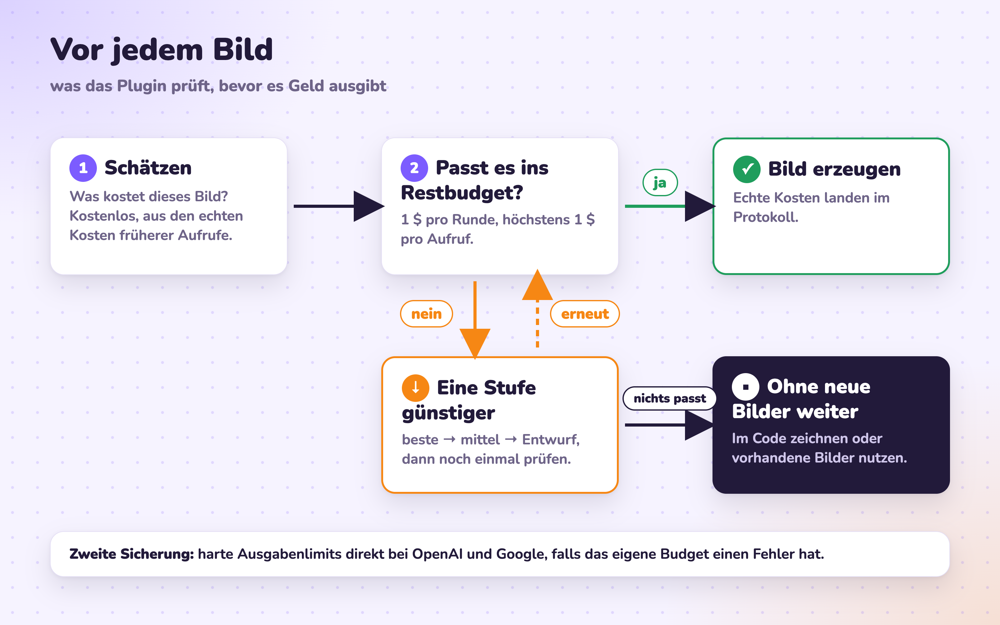
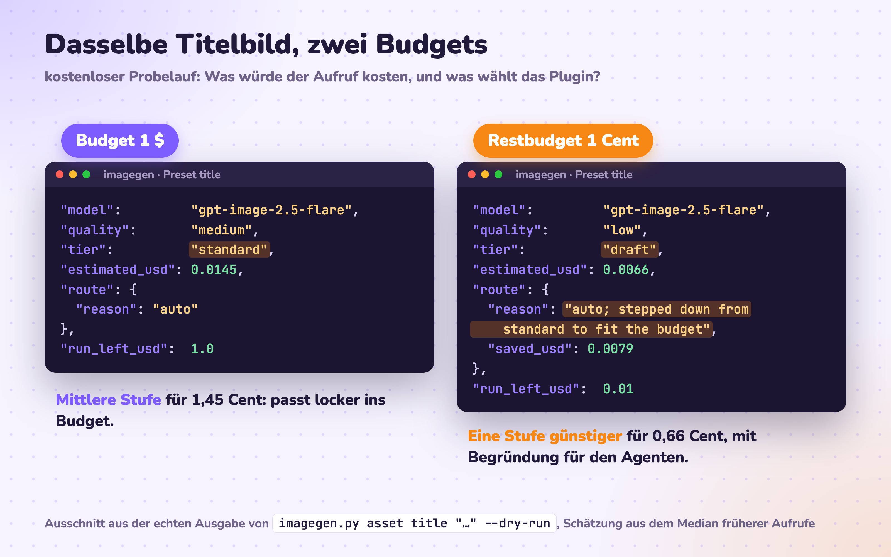
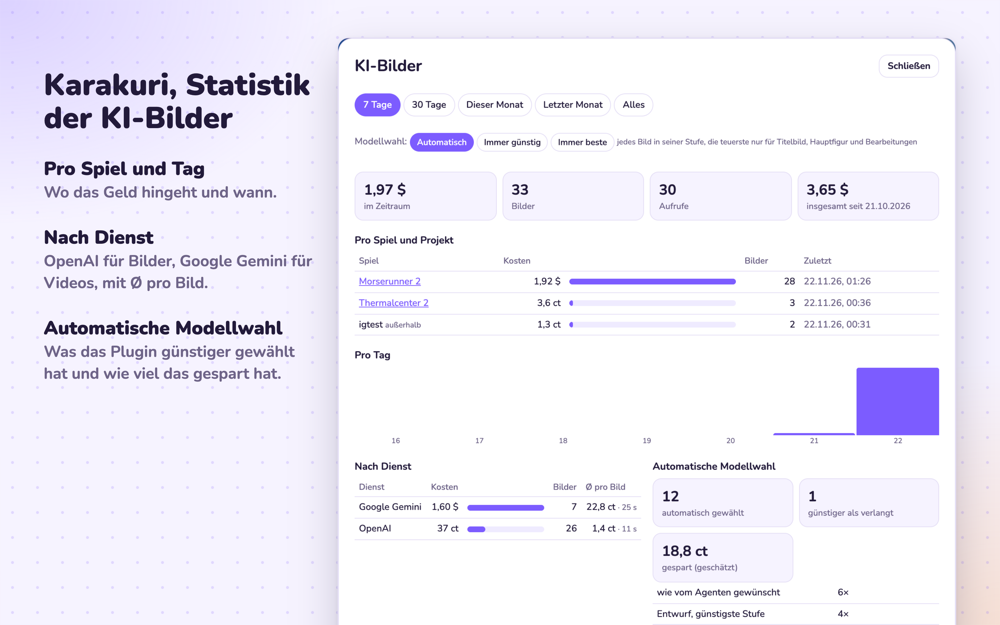

**Seit meine Software Factory Bilder erzeugt, gibt Claude echtes Geld aus. Jeder Aufruf kostet ein paar Cent, und während der Agent eine Runde baut, schaut niemand zu. Die Frage war nicht, ob er Geld ausgeben darf. Sondern wie viel, und wer entscheidet.**

---

Im [letzten Artikel](https://blog.tobiaswust.de/claude-kann-nicht-zeichnen/) habe ich gezeigt, wie Claude in [Karakuri](https://blog.tobiaswust.de/mein-eigener-app-store/), meiner Fabrik für Browser-Spiele, mit meinem Plugin imagegen echte Spielgrafik erzeugt. Die Bild- und Videomodelle dahinter rechnen pro Aufruf ab. Ein Agent, der selbstständig arbeitet, kann also auch selbstständig Geld ausgeben.

Die einfachste Lösung wäre ein Verbot gewesen: Bilder nur auf Knopfdruck, jeder Aufruf mit Rückfrage. Dann wäre der Agent wieder ein Werkzeug, das ich bediene. Ich habe mich für das entschieden, was man auch einem neuen Mitarbeiter gibt: ein Budget.

## Ein Spesenlimit für den Agenten

- **1 Dollar pro Runde:** Jede Runde, also ein neues Spiel oder ein Änderungswunsch samt Nachbesserungen, bekommt einen festen Betrag.
- **Erst schätzen, dann ausgeben:** Vor jedem Aufruf sagt das Werkzeug kostenlos, was er kosten wird.
- **Lieber günstiger als gar nicht:** Passt ein Bild nicht mehr ins Restbudget, nimmt das Plugin eine günstigere Stufe. Reicht auch die nicht, lautet die Antwort: Budget aufgebraucht, mach ohne neue Bilder weiter.
- **Teuer nur, wo es zählt:** Die teuerste Stufe darf der Agent nur für Titelbild, Hauptfigur und Bearbeitungen verlangen. Alles andere senkt das Plugin auf die mittlere Stufe.

Innerhalb dieses Rahmens entscheidet der Agent selbst. Wird das Geld knapp, bricht er nicht ab. Er wird sparsamer.

## Messen, bevor man begrenzt

Ein Budget ist nur so gut wie die Schätzung dahinter. Meine ersten Schätzungen lagen bei Bildern mit Referenzbildern zwei- bis dreimal zu hoch. Der Agent hätte damit Bilder ausgelassen, die er sich leisten konnte. Heute rechnet das Plugin mit dem Median der eigenen bisherigen Aufrufe: gleiches Modell, gleiche Qualität, gleich viele Referenzbilder.

Jeder Aufruf landet mit den tatsächlichen Kosten in einem Protokoll. Daraus baut Karakuri eine Übersicht: pro Spiel, pro Tag, nach Dienst und Modell, und was die automatische Modellwahl gespart hat. Alle KI-Bilder bisher haben zusammen 3,65 Dollar gekostet, die komplette Neugestaltung von Morserunner 2 davon 1,92 Dollar.

Dazu kommt eine zweite Sicherung, falls mein eigenes Budget einen Fehler hat: harte Ausgabenlimits direkt bei OpenAI und Google.

## Die zweite Währung: Zeit

Claude selbst läuft über mein Abo, nicht per Token. Karakuri ignoriert dafür sogar einen gesetzten API-Schlüssel. Ein Auftrag kostet dort kein Geld, sondern Kontingent. Ist das Nutzungslimit erreicht, pausiert die Warteschlange und läuft nach dem Reset von selbst weiter. Auch das ist ein Budget, nur in Zeit statt in Euro.

## Was ich daraus mitnehme

Ein Verbot hätte mir Kontrolle gegeben und dem Agenten die Selbstständigkeit genommen. Ein Budget lässt ihn abwägen: teuer, wo es zählt, günstig, wo es reicht, und ohne, wenn nichts mehr da ist. **Autonomie braucht ein Budget, kein Nein.** Und ein Budget braucht ehrliche Zahlen.

---

**Wie viel würdet ihr einen KI-Agenten pro Auftrag selbstständig ausgeben lassen?**

*Bilder: echte Oberflächen und Ausgaben von Karakuri und imagegen.*
