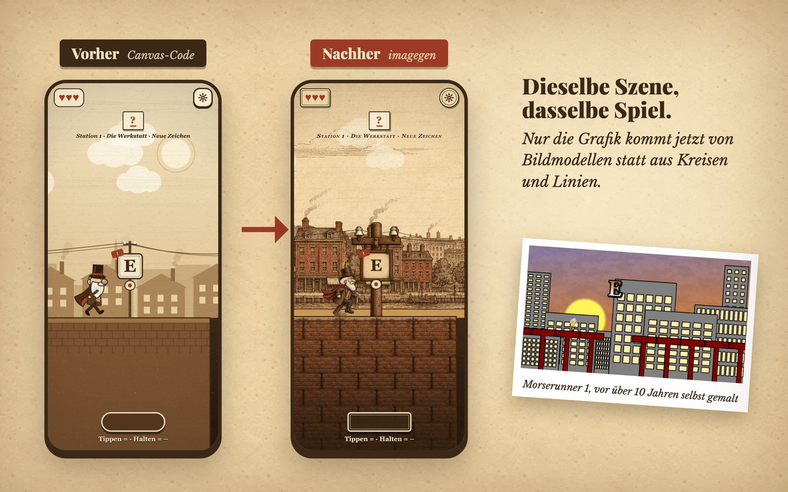
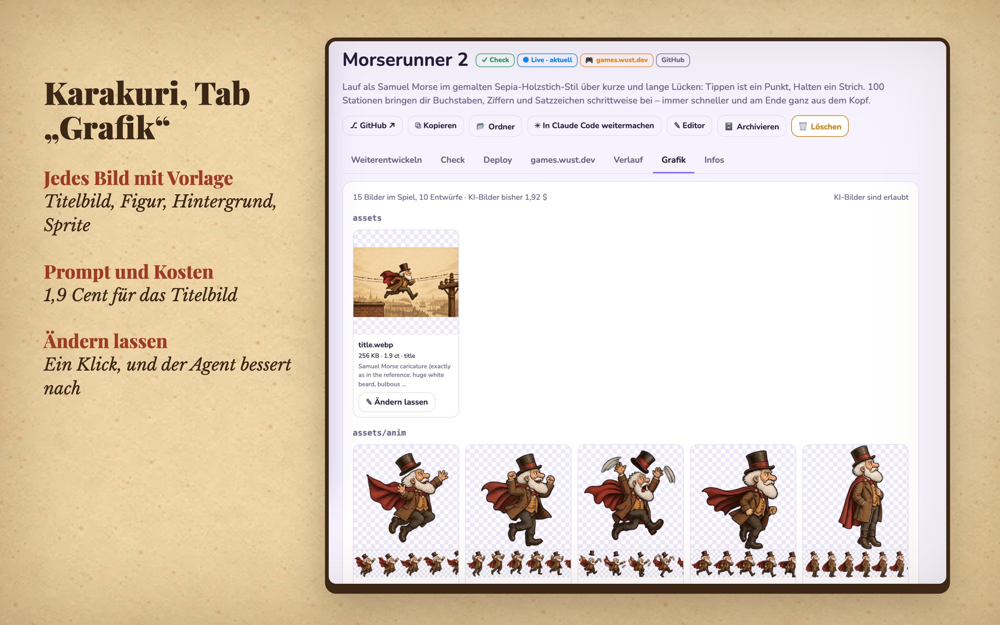
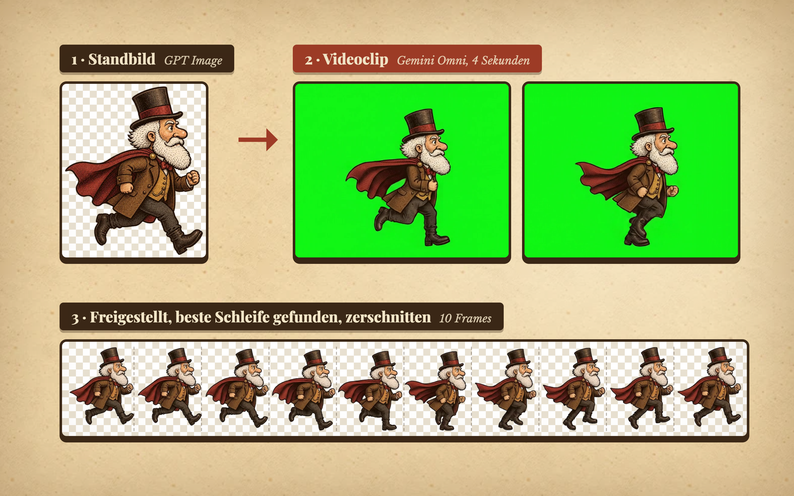

**Morserunner 2 lief, war schnell und machte Spaß. Nur sah es aus wie ein Spiel von einem Entwickler: Samuel Morse aus Kreisen, Linien und Farbflächen, gezeichnet von 742 Zeilen Canvas-Code. Sauber, aber ohne Charakter. Ein besserer Prompt hätte daran nichts geändert.**

---

Die [erste Version von Morserunner](https://morserunner.wust.io/) habe ich vor über zehn Jahren noch selbst gemalt und programmiert. Für den Nachfolger sollte das die KI übernehmen.

In [Karakuri](https://blog.tobiaswust.de/mein-eigener-app-store/), meiner Fabrik für Browser-Spiele, baut Claude jedes Spiel selbst. Code, Logik, Texte, Tests: Das kann es richtig gut. Grafik kann es nicht. Es kann ein Bild nur aus Code zusammensetzen. Das ergibt saubere Formen, aber keine Figur, die man sich merkt.

Also habe ich Claude ein eigenes Werkzeug gegeben: **imagegen**, ein Plugin für Claude Code, das echte Bildmodelle anspricht. Claude zeichnet nicht mehr selbst, es beauftragt.

## Vom Zeichner zum Art Director

Ein Bildmodell allein macht noch keine Spielgrafik. Jedes Bild sähe anders aus, hätte einen weißen Rand oder einen Schatten, wo keiner hingehört. Deshalb steckt in imagegen der Teil, den sonst ein Grafiker übernimmt:

- **Erst der Stil:** Claude schlägt einen Stil vor und zeigt ein Demo-Bild. Bei Morserunner 2 war das ein Sepia-Holzstich aus den 1840ern. Erst wenn ich zustimme, geht es weiter.
- **Dann feste Regeln:** Stilbeschreibung und Referenzbilder hängen automatisch an jedem Aufruf. So bleibt Samuel auf jedem Bild derselbe.
- **Vorlagen statt freier Prompts:** Figur, Posen, Hintergrund, Icon, Titelbild. Jede Vorlage kennt Format, Transparenz und Nachbearbeitung.
- **Claude sieht hin:** Jedes Ergebnis kommt als Vorschau zurück. Passt es nicht, erzeugt Claude es neu.

Alle Standbilder für das Spiel, samt Entwürfen und zweiten Versuchen, haben zusammen 32 Cent gekostet.

## Wo ein Modell nicht reicht

Dann kam meine Rückmeldung: „Die Laufanimation ist noch ziemlich steif.“ Zu Recht. Ein Bildmodell liefert Standbilder. Zwei Posen im Wechsel ergeben kein glaubwürdiges Laufen.

Hier zeigt sich, warum es mehrere Modelle braucht. imagegen holt für Bewegung ein Videomodell dazu, Gemini Omni von Google. Claude erzeugt Samuel als Standbild, Omni lässt ihn auf der Stelle laufen. Das Plugin stellt die Figur frei, sucht im Clip die sauberste Schleife und schneidet sie in einzelne Frames. Am Ende liegt ein Sprite-Streifen im Spiel, wie ihn ein Animator gezeichnet hätte.

Welches Modell wofür, entscheidet das Plugin selbst. Für Entwürfe und kleine Sprites nimmt es die günstige Stufe, die teure nur für Titelbild und Hauptfigur. Bewegung ist trotzdem der teure Teil: Ein Clip kostet 9 bis 28 Cent, die fünf Animationen von Samuel samt Probeläufen zusammen 1,60 Dollar. Fünfmal so viel wie alle Bilder.

## Was ich daraus mitnehme

Die naheliegende Reaktion wäre gewesen, Claude mit noch genaueren Prompts zu besseren Canvas-Zeichnungen zu bringen. Das hätte nie gereicht. Ein Agent muss nicht alles selbst können. **Er braucht die richtigen Werkzeuge und den Blick dafür, was gut ist.** Den Blick hat Claude. Die Werkzeuge musste ich bauen.

---

Ausprobieren könnt ihr Morserunner 2 unter **[morserunner-2.wust.io](https://morserunner-2.wust.io)**, zusammen mit den anderen Spielen auf **[littlelift.games](https://littlelift.games/en/games/)**.

**Bei welcher Aufgabe lasst ihr eure KI noch etwas selbst machen, wofür es längst ein besseres Werkzeug gäbe?**

*Bilder: echte Oberflächen von Karakuri und Morserunner. Die Grafik von Morserunner 2 ist KI-erzeugt, die von Morserunner 1 ist selbst gemalt.*
