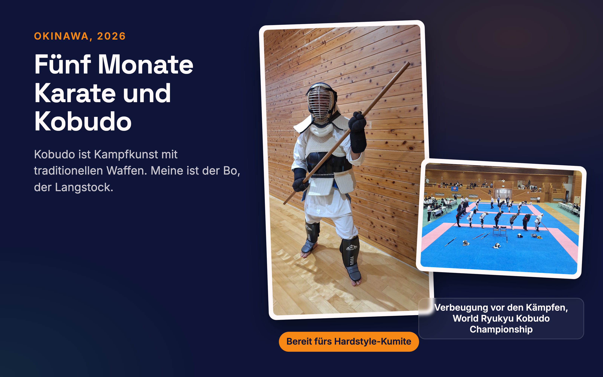
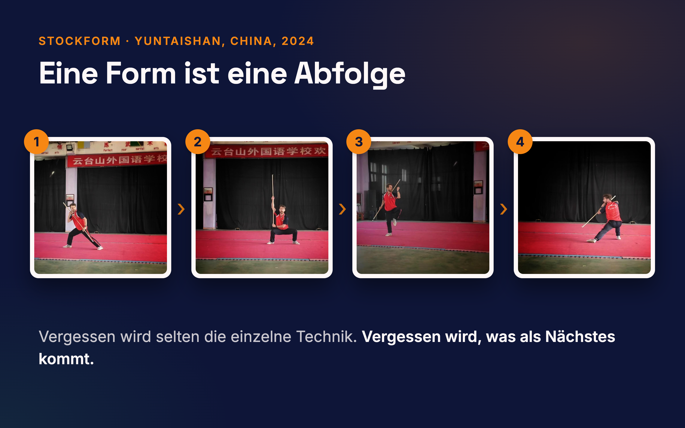
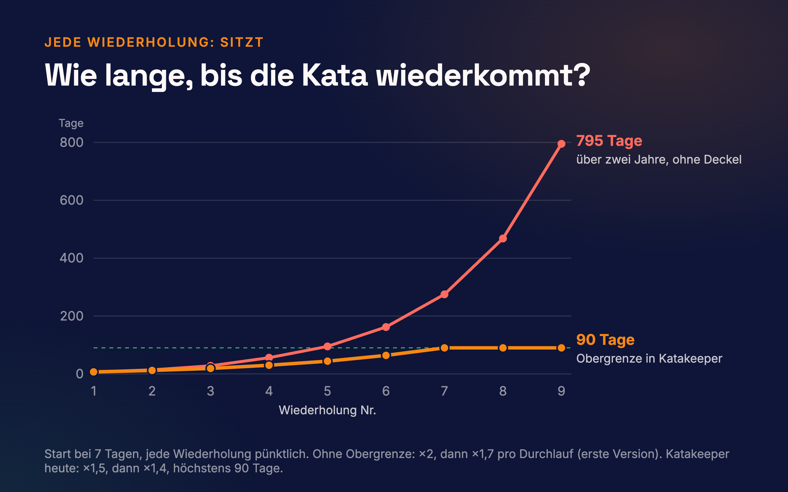
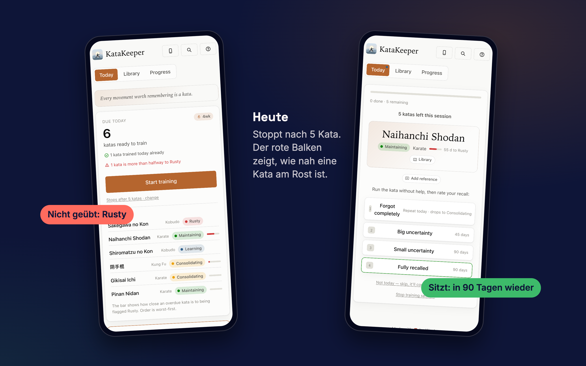

**Training ist wie ein Stapel Papier. Jeder Tag, an dem du trainierst, legt ein Blatt oben drauf. Jeder Tag ohne Training nimmt eins wieder weg. Wer mir das erzählt hat, weiß ich nicht mehr genau. Ich glaube, es war auf Okinawa.**

---

Dort war ich dieses Jahr fünf Monate, um Karate und Kobudo zu trainieren, also Kampfkunst mit traditionellen Waffen wie dem Langstock. Vor knapp drei Jahren waren es sechs Monate Kung Fu im Shaolin-Stil, an einer Schule am Yuntaishan in China. Seitdem habe ich ein Problem, das jeder kennt, der Formen lernt: Es sind zu viele, um sie alle frisch zu halten.

Eine Form, im Karate Kata genannt, ist eine feste Abfolge von Bewegungen. Vergessen wird selten die einzelne Technik. Vergessen wird die Reihenfolge.

## Die KI kennt das Lehrbuch

Für Vokabeln gibt es dafür seit Jahren Spaced Repetition, etwa mit Anki: Wer eine Karte gut kann, sieht sie erst in ein paar Tagen wieder, dann in Wochen, dann in Monaten. Genau das wollte ich für meine Kata. Also habe ich mir mit Claude Code [Katakeeper](https://katakeeper.com) gebaut. Gedacht war es für Kata, es passt aber zu jeder Bewegung, die man als Abfolge lernt: Tai-Chi-Formen, Tanzchoreografien, Yoga-Flows. Am ersten Tag stand die Planungslogik, sauber und mit Tests.

Nur fühlte sie sich falsch an. Bei jeder gut bewerteten Kata wuchs der Abstand weiter. Ab einer Woche Abstand lag eine Kata nach drei guten Durchläufen zwei Monate in der Schublade, nach fünf weiteren über zwei Jahre. Für eine Vokabel ist das in Ordnung. Für eine Kata nicht: Dass ich mich an die Abfolge erinnere, heißt nicht, dass mein Körper sie noch flüssig läuft.

## Der Stapel im Code

Die Korrekturen kamen nicht von der KI, sondern aus dem Training:

- **Kein Abstand über 90 Tage.** Auch eine Kata, die perfekt sitzt, kommt spätestens nach drei Monaten wieder dran.
- **Rost statt Vergessen.** Wer zu lange nicht übt, rutscht von selbst auf „Rusty“, egal wie gut die Kata einmal saß. Kein Knopfdruck, nur die Zeit. Das ist das Blatt, das wieder vom Stapel geht.
- **Ein Training hat ein Ende.** Eine Sitzung stoppt nach einer festen Zahl Kata, wie eine echte Trainingseinheit. Niemand läuft an einem Abend 40 Formen.
- **Ehrliche Bewertungen.** Statt „leicht“ oder „schwer“ frage ich: vergessen, große Unsicherheit, kleine Unsicherheit, sitzt.

Ganz so streng wie der Papierstapel ist die App trotzdem nicht. Das Wochenziel sind zwei Trainingstage, nicht sieben. Ich will, dass sie mich zum Training bringt, nicht, dass ich sie wegen jedem verpassten Tag lösche.

## Was ich daraus mitnehme

Den Standard-Algorithmus hatte Claude an einem Tag gebaut. Die Monate danach habe ich damit verbracht, ihn an das anzupassen, was ich in Dojos gelernt habe. Diese Abweichungen machen die App aus, und keine davon stand in einem Prompt, bevor ich sie selbst erlebt hatte. **Die KI kennt das Lehrbuch. Das Dojo kennst du.**

---

**Welches Wissen aus eurem Leben außerhalb der Arbeit steckt in eurer Software?**

Katakeeper könnt ihr kostenlos und ohne Konto ausprobieren: [katakeeper.com](https://katakeeper.com)

*Bilder: eigene Fotos aus Okinawa und China, Screenshots von Katakeeper mit Demo-Daten.*
