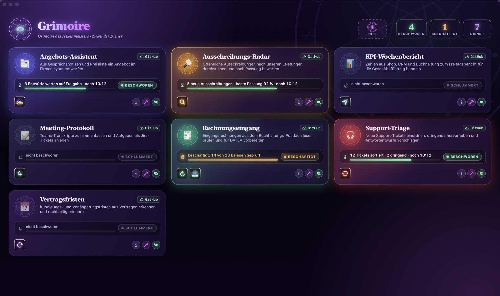

**Als Hexenmeister in World of Warcraft habe ich gelernt, Helfer zu beschwören und zu führen. Heute arbeite ich mit KI-Agenten, und das Prinzip gilt weiter: Wer delegiert, behält die Kontrolle.**

---

Seit einiger Zeit lasse ich mir von KI-Agenten kleine Werkzeuge für den Alltag bauen. Die erste Version war dabei nie das Problem. Schwierig wurde es immer erst später.

Nehmen wir ein typisches Werkzeug: Es holt Eingangsrechnungen aus dem Buchhaltungs-Postfach, liest Lieferant, Betrag und Fälligkeit aus und bereitet alles für den DATEV-Export vor. Ein Satz an Claude Code, ein paar Rückfragen, fertig.

Zwei Wochen später kommt der nächste Wunsch:

> „Gleiche jede Rechnung mit der offenen Bestellung im ERP ab. Weicht der Betrag um mehr als 2 % ab, kommt sie nicht in den DATEV-Export, sondern in eine Liste ‚Klären‘.“

Klingt nach einer kleinen fachlichen Änderung. Tatsächlich bekommt das Werkzeug damit einen **neuen Zugriff auf ein Kernsystem**, und es entscheidet künftig, **welche Belege in den DATEV-Export gelangen**. Ein KI-Agent setzt das in Minuten um. Auf Autopilot würde er es auch gleich live schalten.

Bei Grimoire wollte ich stattdessen drei Dinge sichtbar machen: Was muss fachlich geklärt werden? Welcher Zugriff kommt hinzu? Wer gibt die Änderung frei?

## Wie aus einem Hexenmeister ein Grimoire wurde

Früher habe ich mit Leidenschaft einen Hexenmeister gespielt. Was mich an der Klasse fasziniert hat: Er muss nicht alles selbst können. Er muss wissen, welchen Diener er wann ruft. Genau dieses Bild hatte ich im Kopf, als meine Sammlung KI-gebauter Werkzeuge unübersichtlich wurde. Daraus ist **Grimoire** entstanden, benannt nach dem Zauberbuch des Hexenmeisters.

Grimoire ist eine Mac-App, in der KI-Agenten kleine Werkzeuge bauen, betreiben und weiterentwickeln. Jedes Werkzeug ist eine Karte im Dashboard. Ein Klick startet es, eine Statuszeile sagt, was los ist („14 von 23 Belegen geprüft · 2 Abweichungen“), und wenn niemand es braucht, beendet es sich von selbst.

Die Werkzeuge heißen deshalb **Diener**: Sie werden **beschworen**, erledigen ihre Aufgabe, **verblassen** im Leerlauf und lassen sich **bannen**. Hinter dem spielerischen Auftritt stehen drei Entscheidungen, die ich bewusst getroffen habe.

## Entscheidung 1: Ein Vertrag für jedes Werkzeug

KI-Agenten bauen in Grimoire nie „irgendwas“. Sie bauen gegen den **Diener-Vertrag**, eine feste Spezifikation, die jedes Werkzeug erfüllen muss, egal in welcher Sprache und von welchem Agenten es geschrieben wurde:

- eine Beschreibungsdatei mit Zweck, Startbefehl, Abhängigkeiten, Einrichtungsschritten und den Namen der benötigten Zugangsdaten,
- einheitliche Schnittstellen für Status und Steuerung,
- Statuszeile, Ein-Klick-Aktionen und zeitgesteuerte Rituale, etwa den Postfachabruf um 06:00,
- verbindliche Sicherheitsvorgaben für den Betrieb.

Grimoire prüft die Einhaltung automatisch. Das Ergebnis sind keine zwanzig Einzelstücke, sondern zwanzig Werkzeuge, die sich gleich verhalten, gleich gesichert werden und sich auf einen anderen Mac umziehen lassen.

## Entscheidung 2: Drei Fragen, drei Freigaben

Zurück zur ERP-Änderung. Grimoire hält an drei Stellen an. Bei mir landen alle drei Fragen auf demselben Bildschirm, aber es sind drei grundverschiedene Entscheidungen.

**Die fachliche Rückfrage: „Woran erkennt der Agent die passende Bestellung?“** Bestellnummer auf der Rechnung? Lieferant und Datum? Und was ist mit Abos ohne Bestellung? Das ist eine fachliche Entscheidung, und die treffe ich, nicht der Agent.

**Die Zugriffsfreigabe: „Darf das Werkzeug offene Bestellungen im ERP lesen?“** Der Agent arbeitet in einer Sandbox. Will er ein neues System erreichen, erscheint eine Rückfrage mit genau diesem Ziel. Das ist eine Sicherheitsentscheidung.

**Die Freigabe der Version: „Soll die neue Exportregel ab jetzt gelten?“** Vor dem Übernehmen zeigt Grimoire, welche Dateien neu oder geändert sind, und markiert Hinweise auf neue Netzwerkzugriffe. Ich muss dafür nicht jede Zeile lesen. Ich sehe, dass das Werkzeug künftig aufs ERP zugreift, und entscheide, ob das zu meinem Auftrag passt. Erst nach „Übernehmen“ geht die Version live und landet in der Chronik.

<figure>
  <video src="/media/grimoire-weiterentwicklung.mp4" controls playsinline preload="metadata"></video>
  <figcaption>Echte Aufnahme, gekürzt: Wunsch, Freigabe für den EZB-Zugriff, Prüfschritt und das Ergebnis in Euro.</figcaption>
</figure>

In einem Unternehmen lägen diese drei Fragen bei verschiedenen Menschen: Fachabteilung, IT und wer die Verantwortung trägt. Gerade deshalb halte ich die Trennung für entscheidend, sobald KI-Agenten aus dem Einzelprojekt ins Team wachsen.

Die richtige Dosis war dabei die eigentliche Arbeit. In einer frühen Version hat Grimoire jede Rückfrage des Agenten weitergereicht. Claude Code legt aber viele harmlose Befehle schon wegen ihrer Form zur Freigabe vor, obwohl sie die Sandbox nie verlassen. Wer zehnmal am Tag Harmloses bestätigt, liest die elfte Rückfrage nicht mehr genau. Deshalb erlaubt Grimoire heute alles, was in der Sandbox bleibt, selbst und fragt nur noch bei vier Dingen: einem neuen Ziel im Netz, Befehlen außerhalb der Sandbox, Eingriffen in Systemeinstellungen und Dateien außerhalb des Projekts. **Weniger Rückfragen machen jede einzelne wertvoller.**

## Entscheidung 3: Sicherheit als Konzept, nicht als Nachgedanke

- **Beim Bauen:** Sandbox für den Agenten, Schreibrechte nur im eigenen Projekt, Internetzugriff nur auf freigegebene Quellen, alles Weitere nur nach Freigabe.
- **Im Betrieb:** Die Werkzeuge laufen lokal auf dem Mac und sind von außen nicht erreichbar. Der Vertrag schreibt zusätzlich Schutz gegen Angriffe über manipulierte Webseiten vor.
- **Zugangsdaten** liegen im macOS-Schlüsselbund, nie im Projekt und nie in Sicherungen.
- **Keine Alleingänge:** Grimoire veröffentlicht keinen Code selbstständig, und Entferntes landet im Papierkorb statt endgültig gelöscht zu werden.

Das Konzept ist in einem eigenen Sicherheitsdokument festgehalten, Schicht für Schicht.

## Was ich daraus mitnehme

Bei Grimoire war die erste Version eines Werkzeugs meist schnell gebaut. Die eigentliche Arbeit begann bei der zweiten: Welche Fragen muss der Agent stellen, welche Zugriffe braucht er, und was muss ein Mensch sehen, bevor er die Änderung freigibt? Ganz wie beim Hexenmeister: Die Diener machen die Arbeit, aber wer sie ruft, entscheidet.

---

Wenn ihr KI-Agenten nicht nur ausprobieren, sondern **strukturiert und sicher** in den Arbeitsalltag bringen wollt, lasst uns sprechen.

**An welcher Stelle würdet ihr eure KI auf keinen Fall ohne Rückfrage arbeiten lassen?**
