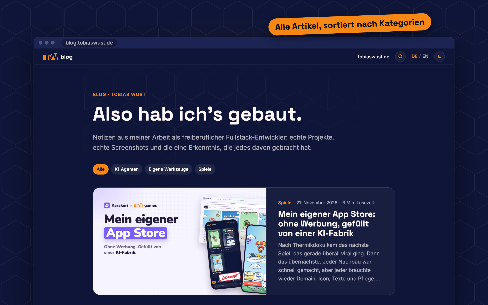
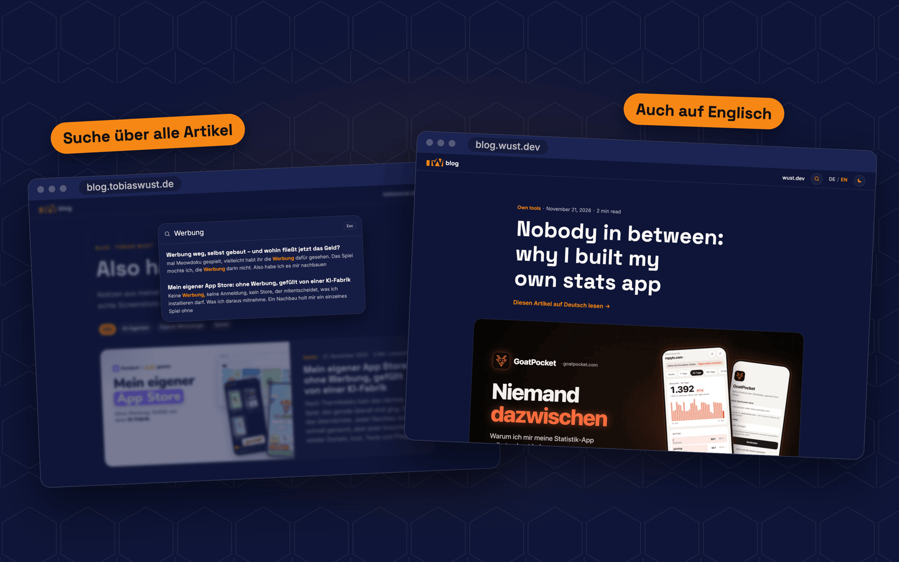

**Fünf Artikel habe ich in den letzten Wochen für LinkedIn geschrieben. Als ich sie an einem Ort sammeln wollte, kam die Überraschung: LinkedIn gibt sie nicht so einfach wieder heraus. Eine Schnittstelle dafür gibt es nicht, nur einen Datenexport von Hand.**

---

Deshalb habe ich jetzt einen eigenen Blog: **[blog.tobiaswust.de](https://blog.tobiaswust.de)** auf Deutsch und **[blog.wust.dev](https://blog.wust.dev)** auf Englisch. Alle bisherigen Artikel sind schon dort, in beiden Sprachen. Neue Artikel erscheinen ab jetzt zuerst dort.

## Meine Texte gehören mir

Auf LinkedIn liegt ein Artikel auf einer fremden Plattform. Wie er angezeigt wird, wer ihn sieht und ob es ihn in fünf Jahren noch gibt, entscheide nicht ich. Auf dem Blog ist jeder Artikel eine einfache Textdatei in meinem eigenen Repository, mit den Bildern daneben. Die kann ich mitnehmen, wohin ich will.

## Auffindbar statt nach zwei Tagen weg

Im Feed ist ein Artikel nach zwei, drei Tagen durchgescrollt. Auf dem Blog bleibt er auffindbar: über Google, über die Suche, über Kategorien und per [RSS-Feed](https://blog.tobiaswust.de/rss.xml), für alle, die lieber in ihrem Feed-Reader lesen als im Algorithmus.

## Ein Ort für alles

Bisher waren meine Projekte verteilt: die Website auf [wust.dev](https://wust.dev), die Spiele auf [littlelift.games](https://littlelift.games/en/games/), die Artikel auf LinkedIn. Jetzt gehören sie sichtbar zusammen, mit derselben Menüleiste und gegenseitig verlinkt. Wer wissen will, woran ich arbeite und was ich dabei lerne, findet es an einem Ort.

## Was sich für euch ändert

Nichts Großes. Meine Artikel kommen weiterhin auch auf [LinkedIn](https://www.linkedin.com/in/tobias-wust/), und ich freue mich dort wie bisher über eure Kommentare. Unter jedem Artikel steht dort nur, wo das Original liegt. **Wer auf fremden Plattformen schreibt, sollte das Original selbst besitzen.**

---

**Lest ihr Fachartikel lieber im Feed oder auf Blogs und per RSS?**
