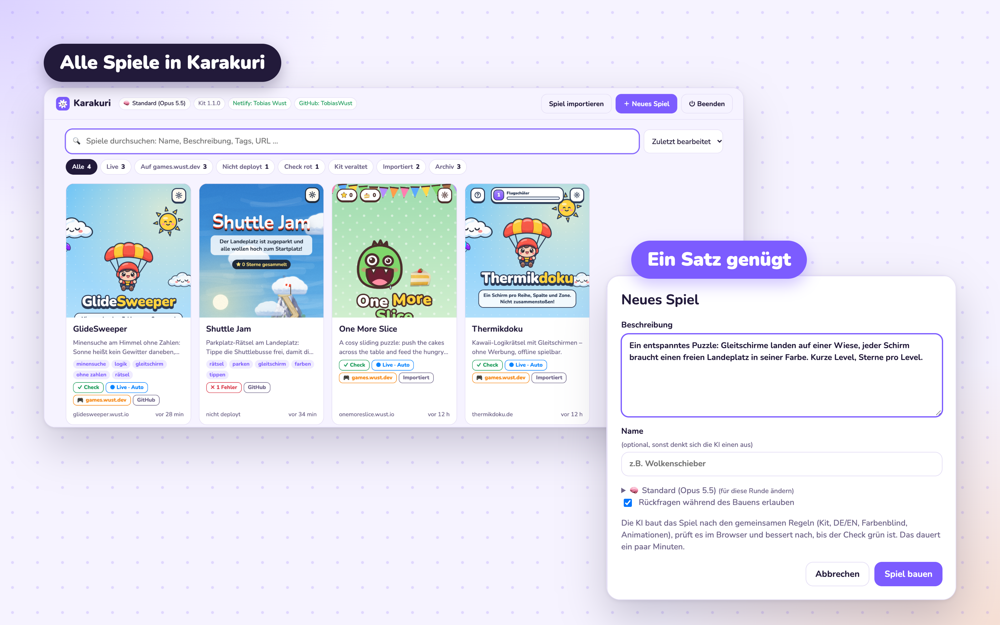
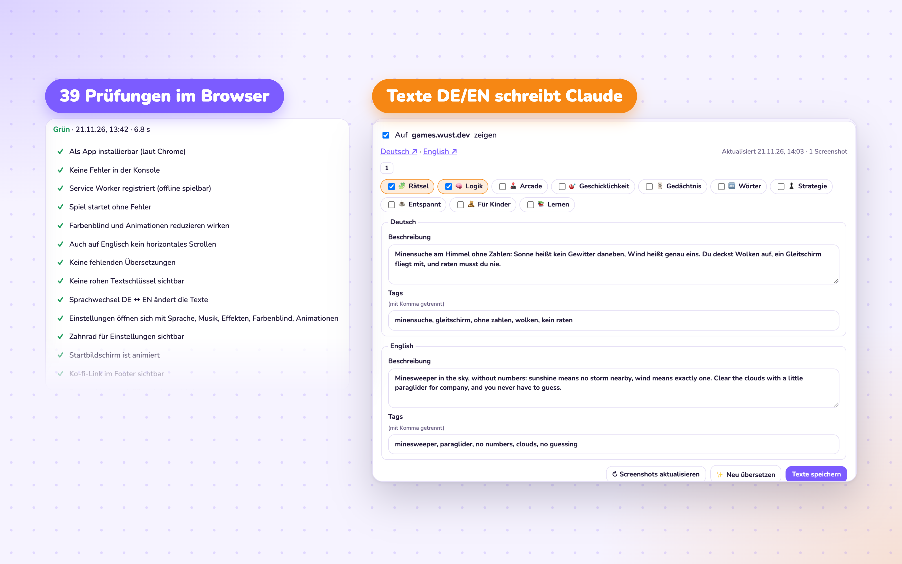
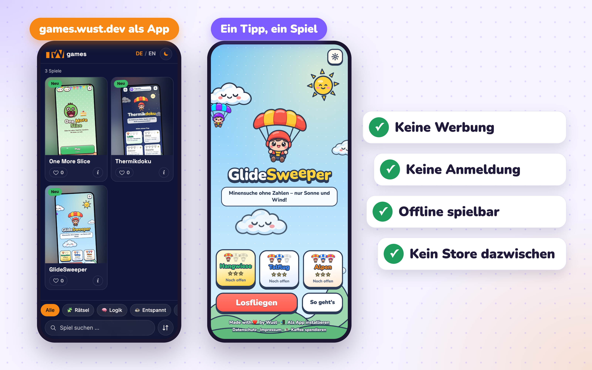

**Nach Thermikdoku kam das nächste Spiel, das gerade überall viral ging. Dann das übernächste. Jeder Nachbau war schnell gemacht, aber jeder brauchte wieder Domain, Icon, Texte und Pflege. Irgendwann war klar: Ich brauche nicht das nächste Spiel, sondern meinen eigenen App Store.**

---

Also habe ich mir an einem Tag zwei Dinge gebaut: **Karakuri**, eine Fabrik für Browser-Spiele, und **games.wust.dev**, den Launcher, in dem die Spiele landen. Gebaut haben beides die KI-Agenten in Grimoire, meiner Software Factory für eigene Werkzeuge.

Der Name kommt von den japanischen Karakuri-Puppen: mechanische Figuren, die ohne Zutun Tee servieren. Genau das soll die Fabrik tun. Ich beschreibe ein Spiel in einem Satz, den Rest erledigt sie.

## Regeln statt Einzelstücke

Ein schneller Nachbau ist noch kein gutes Spiel. Deshalb baut Claude in Karakuri nie „irgendwas“, sondern gegen feste Regeln und ein gemeinsames Kit. Jedes Spiel hat dieselben Einstellungen, läuft auf Deutsch und Englisch, hat einen Farbenblind-Modus, funktioniert offline und lässt sich als App installieren.

Ob das stimmt, prüft Karakuri selbst. Nach jeder Änderung öffnet es das Spiel im echten Browser und geht 39 Prüfungen durch: von „keine Fehler in der Konsole“ bis „Tippflächen groß genug“. Ist etwas rot, bessert Claude bis zu zweimal nach. Live geht nur, was grün ist. Ob ein Spiel Spaß macht, prüft aber kein Check. Deshalb spiele ich jedes selbst ausgiebig, bevor ich das Häkchen setze.

## Vom Prompt bis aufs Handy, ohne Handarbeit

Der eigentliche Gewinn liegt hinter dem Bauen. Früher blieb genau hier alles liegen: Hosting einrichten, Domain setzen, Beschreibung schreiben, Screenshots machen, in die Übersicht eintragen.

Heute trage ich eine Domain ein und setze ein Häkchen. Karakuri richtet das Hosting ein und stellt das Spiel live. Claude schreibt Beschreibung und Tags auf Deutsch und Englisch und wählt die Kategorien. Vorschaubild und Screenshots kommen mit, und games.wust.dev baut sich neu. Jede neue Version eines Spiels zieht den Eintrag automatisch nach.

## Ein Launcher statt eines Stores

games.wust.dev lässt sich selbst als App auf den Homescreen legen. Am Handy wird die Seite dann zum Launcher: Suche und Kategorien liegen unten in Daumenreichweite, ein Tipp startet das Spiel. Keine Werbung, keine Anmeldung, kein Store, der mitentscheidet, was ich installieren darf.

## Was ich daraus mitnehme

Ein Nachbau holt mir ein einzelnes Spiel ohne Werbung zurück. Das ist nett, aber es skaliert nicht, solange danach Handarbeit liegen bleibt. Erst als der Weg vom Satz bis zum Icon auf dem Homescreen automatisch lief, hatte ich mehr als ein Spiel. **Wer sich die Plattform zurückholen will, muss den letzten Meter automatisieren, nicht nur das Bauen.**

---

Ausprobieren könnt ihr den Launcher unter **games.wust.dev**. Ohne Werbung, versprochen.

**Welches Spiel oder welche App würdet ihr euch als Erstes ohne Werbung nachbauen lassen?**

*Screenshots: echte Oberflächen von Karakuri und games.wust.dev.*
