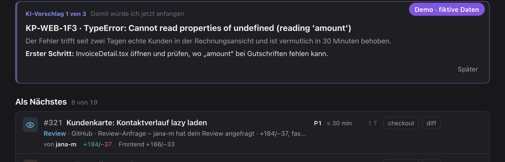
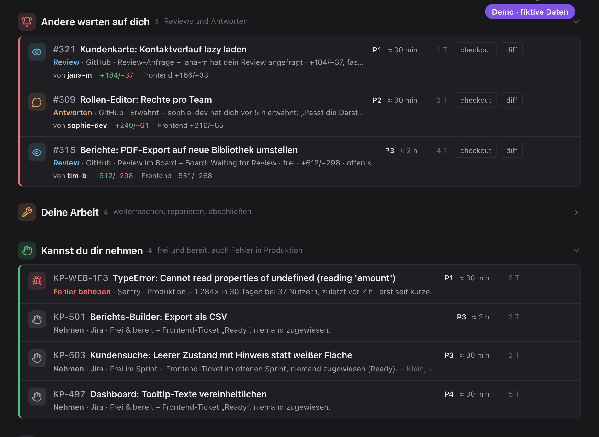
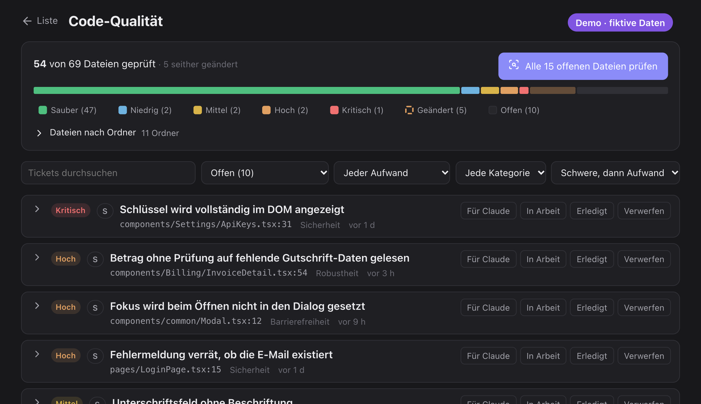
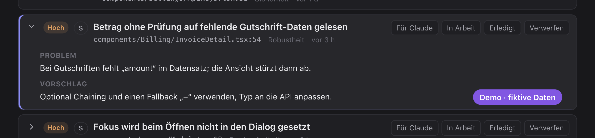
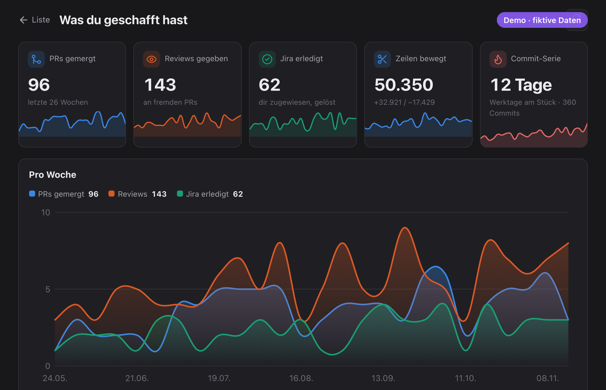

**In GitHub wartet jemand aus dem Team auf mein Review. Sentry meldet einen Fehler in Produktion. In Jira liegt das nächste Ticket bereit. Womit fange ich an?**

---

Für genau diesen Moment habe ich mir **cortex.leerlauf** gebaut. Der Name ist das Ziel: Zwischen zwei Aufgaben soll kein Leerlauf entstehen. Kein Durchklicken durch vier Werkzeuge, kein „Was war noch mal offen?“. Die App holt alles aus Jira, GitHub, Git und Sentry in eine Liste, und Claude schlägt mir vor, womit ich anfange, mit Begründung und erstem Schritt.

## Zwei Arten von „dringend“

Spannend wurde es bei der Frage, was „dringend“ eigentlich heißt. Es gibt zwei Arten davon. Bei einem offenen Review hängt jemand aus dem Team fest, bis ich antworte. Das gilt immer. Ein Produktionsfehler kann dringender sein, muss es aber nicht: Es kommt darauf an, wie viele Nutzer er trifft und wie groß der Fix ist. Das eine ist eine **Regel**. Das andere ist eine **Abwägung**.

Genau so ist die Arbeit in cortex.leerlauf verteilt.

**Die Regeln stehen im Code.** Wer auf mich wartet, was ich sofort nehmen darf und was ich erst mit dem Product Owner klären muss, legt fester Code fest. Nachvollziehbar und jedes Mal gleich.

**Die Abwägung macht Claude.** Die Regel legt fest, in welchen Abschnitt etwas gehört. Die Reihenfolge über die Abschnitte hinweg ist Abwägung. Innerhalb dieses Rahmens schätzt das Modell Aufwand und Priorität und wählt bis zu drei nächste Schritte. In Bild 1 setzt es den Produktionsfehler vor das Review, weil er seit zwei Tagen 37 Nutzer trifft und vermutlich in 30 Minuten behoben ist. Ich lese die Begründung und entscheide.

## Was Claude sieht und was nicht

- **So wenig Daten wie möglich:** Keine Werkzeuge, kein Quellcode, keine Zugangsdaten, keine Ticketbeschreibungen. Nur Titel, eine Kurzbegründung und Kennzahlen pro Eintrag.
- **Eine feste Form für die Antwort:** Sie muss in ein festes JSON-Format passen. Vorschläge zu Einträgen, die es nicht gibt, verwirft die App.
- **Kein Aufruf ohne Anlass:** Claude wird nur gefragt, wenn sich an der Liste etwas geändert hat, und höchstens einmal pro Stunde. Sonst bleibt die letzte Bewertung stehen.

## Codequalität immer im Blick

Und wenn gerade nichts drängt? Dann ist das die beste Zeit zum Aufräumen. Deshalb überwache ich mit cortex.leerlauf ständig die Codequalität. Hier ist es umgekehrt wie bei der Priorisierung: Für diese Prüfung bekommt Claude den Quellcode, darf aber nichts ändern. Claude prüft das Frontend Datei für Datei gegen unsere eigenen Coding-Standards und legt Tickets mit Schwere, Aufwand und Lösungsvorschlag an. Auch hier entscheidet eine Regel, was drankommt: nur Dateien, die neu sind oder sich seit der letzten Prüfung geändert haben. So sehe ich jederzeit, wo die Codebasis steht, und habe immer eine sinnvolle nächste Aufgabe in der Hinterhand.

Die Gegenprobe kommt ganz ohne KI aus: Was ist in den letzten Monaten tatsächlich fertig geworden? Daran sehe ich, ob ich wirklich mehr schaffe oder mich nur besser organisiert fühle.

## Gebaut von meinen eigenen Agenten

Gebaut und weiterentwickelt haben cortex.leerlauf die KI-Agenten in **Grimoire**, meiner Software Factory für interne Werkzeuge. Jede Änderung ist dort ein Satz von mir, etwa: „Sentry-Fehler gehören nicht in ‚Andere warten auf dich‘.“ Umsetzung und Prüfschritt übernimmt Grimoire, live geht die neue Version erst nach meiner Freigabe.

## Was ich daraus mitnehme

Ein gutes KI-System entsteht nicht dadurch, dass man dem Modell möglichst viel überlässt. Sondern dadurch, dass man genau weiß, **wo die Regel endet und die Abwägung beginnt**. Der Nutzen ist am Ende ganz einfach: kein Leerlauf mehr, und ich tue seltener das Falsche.

---

Wenn ihr KI nicht nur ausprobieren, sondern **gezielt dort einsetzen** wollt, wo sie wirklich abwägen muss, lasst uns sprechen.

**Was steht bei euch oben: das Review, auf das jemand im Team wartet, oder der Fehler, den Kunden gerade sehen?**

*Screenshots: Demo mit fiktiven Daten.*
