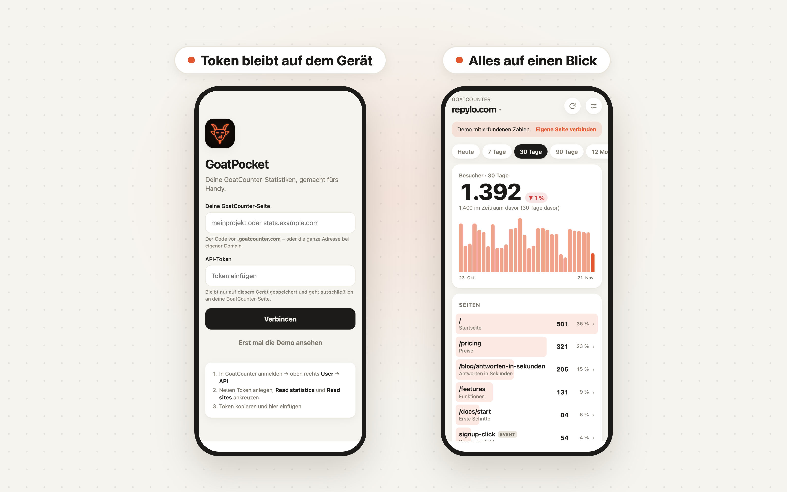
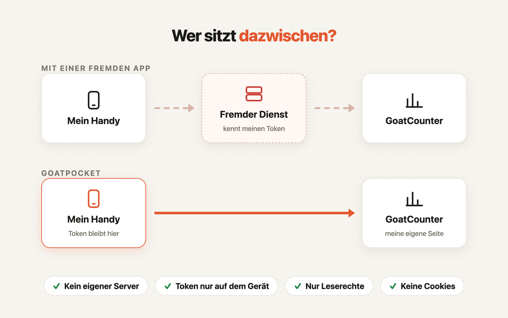
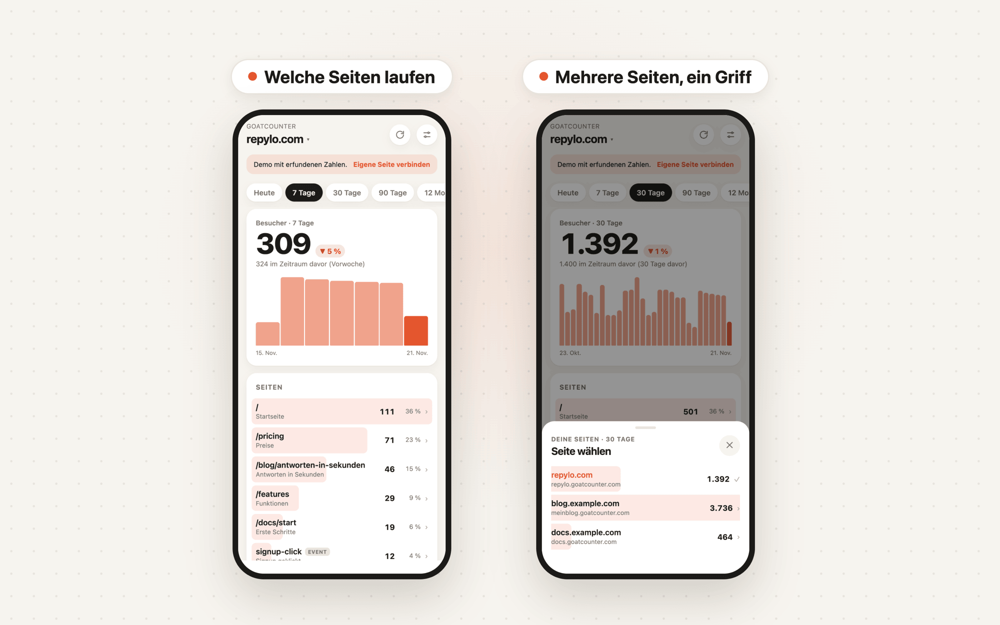

**Wie viele Leute spielen eigentlich gerade Thermikdoku? Die Antwort steht in GoatCounter. Nur ist dessen Oberfläche am Handy so unpraktisch, dass ich jedes Mal den Laptop aufgeklappt habe.**

---

GoatCounter zählt Besuche, ohne Menschen zu verfolgen. Deshalb nutze ich es für meine Projekte. Was fehlte, war eine Ansicht fürs Handy. Also habe ich mir an einem Abend eine gebaut: **GoatPocket**.

## Datenschutz als Bauplan, nicht als Versprechen

Früher hätte ich nach einer fertigen App gesucht und meinen API-Schlüssel einem fremden Dienst anvertraut. Ausgerechnet bei einem Werkzeug, das ich wegen des Datenschutzes gewählt habe.

Heute baue ich so etwas mit Claude Code selbst. Damit ändert sich die Frage. Sie lautet nicht mehr „Welchem Anbieter vertraue ich?“, sondern „Wer muss überhaupt beteiligt sein?“. Bei GoatPocket ist die Antwort: niemand außer mir und GoatCounter.

- **Kein eigener Server:** Es ist eine reine statische Seite, nirgends liegen Daten.
- **Der Token bleibt auf dem Gerät** und geht nur an die eigene GoatCounter-Seite.
- **Nur Leserechte:** Der Token darf Statistiken lesen, sonst nichts.

## Wo Erfahrung trotzdem zählt

Die erste Version lieferte im Betrieb plötzlich Fehler statt Zahlen. GoatCounter erlaubt vier Anfragen pro Sekunde, und der Browser schickt vor jedem Aufruf eine Vorabanfrage, die mitzählt. Jetzt drosselt sich die App selbst und merkt sich Antworten. Solche Grenzen stehen in keinem Prompt. Man findet sie erst im Betrieb.

## Was ich daraus mitnehme

Datenschutz gilt oft als Verzicht. Wenn ein eigenes Werkzeug nur noch einen Abend kostet, stimmt das nicht mehr. **Die datensparsamste Lösung ist oft die, bei der niemand dazwischen sitzt.**

---

Ausprobieren könnt ihr GoatPocket unter **[goatpocket.com](https://goatpocket.com)**, auch ohne eigenes Konto mit Demo-Zahlen.

**Welches kleine Werkzeug würdet ihr euch bauen, damit eure Daten nicht mehr über fremde Server laufen?**

*Screenshots: Demo mit erfundenen Zahlen.*
