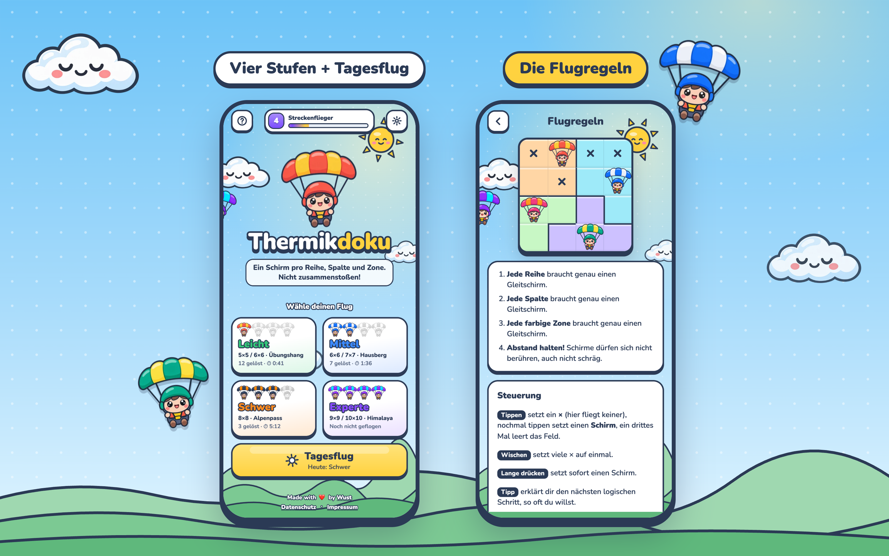
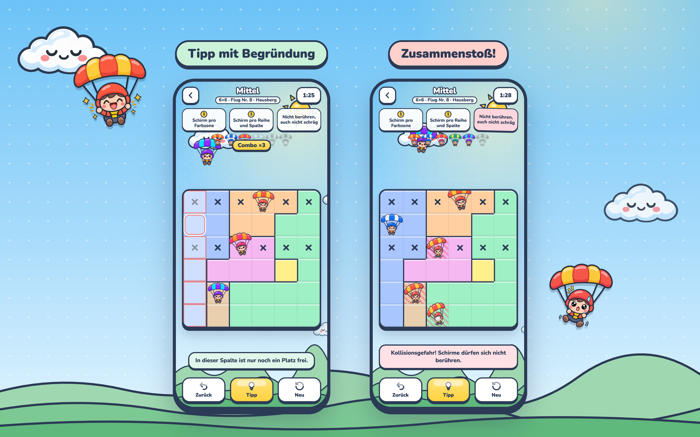
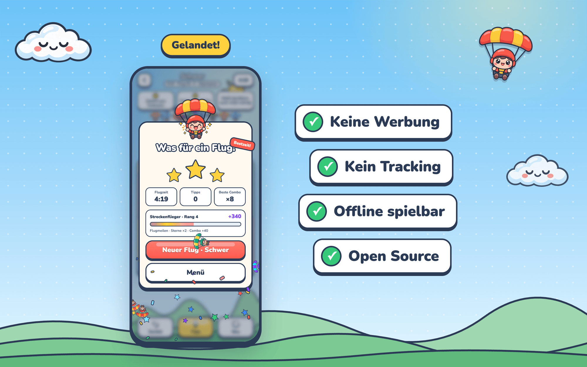

**In letzter Zeit habe ich immer mal Meowdoku gespielt, vielleicht habt ihr die Werbung dafür gesehen. Das Spiel mochte ich, die Werbung darin nicht. Also habe ich es mir nachbauen lassen.**

---

Das Prinzip kennt ihr vielleicht von LinkedIns „Queens“: In jede Reihe, jede Spalte und jede farbige Zone kommt genau eine Figur, und die Figuren dürfen sich nicht berühren. Bei mir sind es Gleitschirmpiloten in Thermikfeldern, deshalb heißt das Spiel **Thermikdoku**.

## Eine Stunde statt ein paar Tage

Gebaut hat es Claude Code, die Figuren hat ChatGPT gemalt. Vom ersten Prompt bis zur fertigen Version verging gut eine Stunde. Jedes Rätsel wird neu erzeugt, hat genau eine Lösung und lässt sich ohne Raten lösen. Der Tipp-Knopf erklärt den nächsten logischen Schritt, statt die Lösung zu verraten.

Hätte ich das früher selbst bauen können? Klar. Aber es hätte mich Tage gekostet, und die hätte ich mir für ein Spiel für die Bahn nie genommen. Heute sind es ein paar Prompts.

## Einerseits: Wir holen uns das Internet zurück

Thermikdoku hat keine Werbung, kein Tracking, keine Anmeldung, und der Code liegt offen auf GitHub. Viele kleine Apps sind voller Werbung, weil ihre Entwicklung teuer war. Kostet ein Nachbau nur noch eine Stunde, kippt diese Rechnung. Dann kann man vieles selbst bauen und als Open Source verschenken.

## Andererseits: Das Geld fließt trotzdem

Umsonst war es nicht. Ich bezahle jeden Monat für Claude. Das Geld, das früher über Werbung bei den Entwicklern eines kleinen Spiels gelandet wäre, geht jetzt an einen der großen KI-Konzerne. Machen das viele, tauschen wir viele kleine Abhängigkeiten gegen ein paar sehr große.

Ich weiß noch nicht, wie ich das finde.

---

Spielen könnt ihr Thermikdoku direkt im Browser: **[thermikdoku.de](https://thermikdoku.de)**. Ohne Werbung, versprochen.

Weitere kleine Spiele für zwischendurch sammle ich ab jetzt auf **[games.wust.dev](https://games.wust.dev)**. Ebenfalls ohne Werbung, ohne Anmeldung und offline spielbar.

**Was meint ihr: Holen wir uns mit KI gerade das Internet zurück, oder geben wir es nur an die nächsten Monopole weiter?**

*Screenshots: echtes Spiel, Spielstand für die Bilder vorbereitet.*
