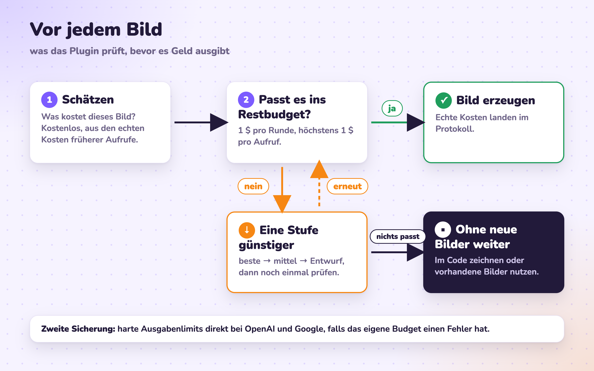
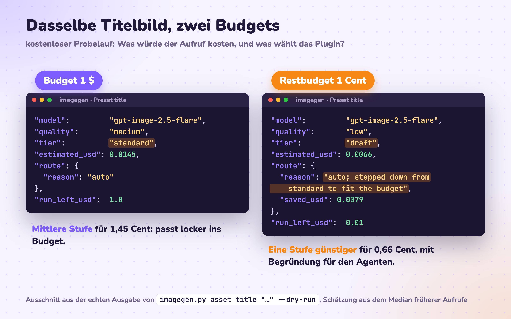
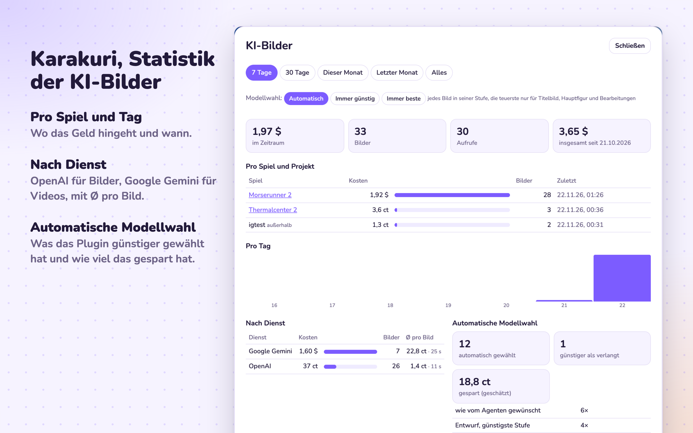

**Since my software factory started generating images, Claude spends real money. Every call costs a few cents, and while the agent builds a round, nobody is watching. The question was never whether it may spend money. It was how much, and who decides.**

---

In my [last article](https://blog.wust.dev/claude-cant-draw/) I showed how Claude, inside [Karakuri](https://blog.wust.dev/my-own-app-store/), my factory for browser games, uses my imagegen plugin to create real game art. The image and video models behind it charge per call. So an agent that works on its own can also spend money on its own.

The simplest fix would have been a ban: images only at the push of a button, every call confirmed first. Then the agent would be back to being a tool I operate. Instead I went with what you'd give a new employee: a budget.

## An expense limit for the agent

- **1 dollar per round:** Every round, meaning a new game or a change request including any follow-up fixes, gets a fixed amount.
- **Estimate first, then spend:** Before every call, the tool tells you for free what it will cost.
- **Cheaper rather than nothing:** If an image no longer fits the remaining budget, the plugin picks a cheaper tier. If even that doesn't fit, the answer is: budget used up, carry on without new images.
- **Expensive only where it counts:** The agent may only ask for the most expensive tier for the title image, the main character and edits. Everything else the plugin lowers to the middle tier.

Within that frame, the agent decides for itself. When money gets tight, it doesn't give up. It gets thriftier.

## Measure before you limit

A budget is only as good as the estimate behind it. My first estimates for images with reference images were two to three times too high. With those, the agent would have skipped images it could actually afford. Today the plugin uses the median of its own previous calls: same model, same quality, same number of reference images.

Every call goes into a log with its actual cost. From that, Karakuri builds an overview: per game, per day, by service and model, and how much the automatic model choice saved. All AI images so far have cost 3.65 dollars in total, 1.92 of that for the complete redesign of Morserunner 2.

On top of that there's a second safety net in case my own budget has a bug: hard spending limits directly at OpenAI and Google.

## The second currency: time

Claude itself runs on my subscription, not per token. Karakuri even ignores an API key if one is set. There, a job doesn't cost money, it costs quota. When the usage limit is reached, the queue pauses and picks up again by itself after the reset. That's a budget too, just in time instead of euros.

## What I'm taking away

A ban would have given me control and taken away the agent's independence. A budget lets it weigh things up: expensive where it counts, cheap where that's enough, and none at all when there's nothing left. **Autonomy needs a budget, not a no.** And a budget needs honest numbers.

---

**How much would you let an AI agent spend on its own per job?**

*Images: real screens and output from Karakuri and imagegen. The labels in the images are in German.*
