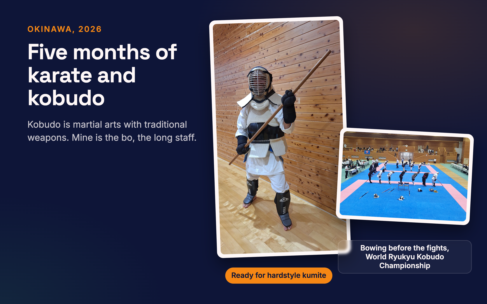
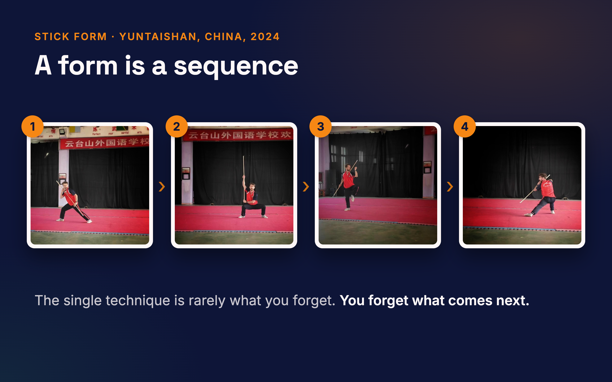
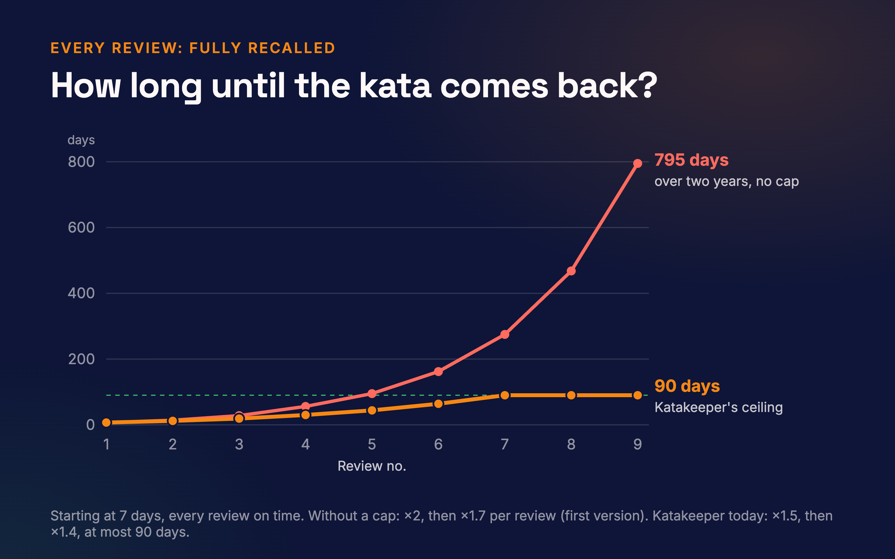
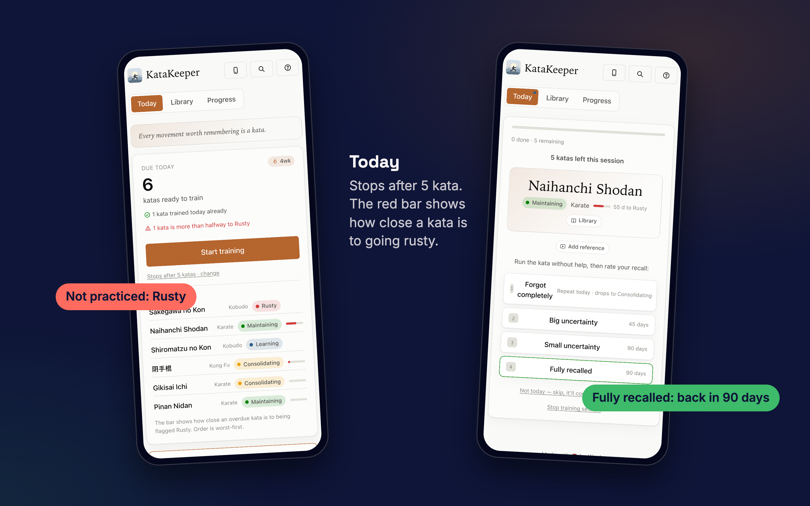

**Training is like a stack of paper. Every day you train, you put a sheet on top. Every day you don't, one comes off again. I don't remember exactly who told me that. I think it was on Okinawa.**

---

I spent five months there this year, training karate and kobudo, the Okinawan martial art with traditional weapons like the long staff. Almost three years ago it was six months of Shaolin-style kung fu at a school at Yuntaishan in China. Since then I have a problem everyone who learns forms knows: there are too many to keep them all fresh.

A form, called kata in karate, is a fixed sequence of movements. What you forget is rarely the single technique. You forget the order.

## The AI knows the textbook

For vocabulary there has been a solution for years: spaced repetition, for example with Anki. If you know a card well, you see it again in a few days, then in weeks, then in months. That's what I wanted for my kata. So I built [Katakeeper](https://katakeeper.com) with Claude Code. I made it for kata, but it works for any movement you learn as a sequence: tai chi forms, dance choreography, yoga flows. On day one the scheduling logic was done, clean and tested.

It just felt wrong. Every time I rated a kata well, the gap grew. Starting at one week, a kata sat in the drawer for two months after three good reviews, and for over two years after five more. For a vocabulary word that's fine. For a kata it isn't: remembering the sequence doesn't mean my body still runs it smoothly.

## The stack in the code

The corrections didn't come from the AI. They came from training:

- **No gap longer than 90 days.** Even a kata that's perfect comes back after three months at the latest.
- **Rust instead of forgetting.** If you don't practice for too long, a kata slides to "Rusty" on its own, no matter how well it once sat. No button, just time. That's the sheet coming off the stack.
- **A session ends.** A training session stops after a set number of kata, like a real class. Nobody runs 40 forms in one evening.
- **Honest ratings.** Instead of "easy" or "hard" I ask: forgot, big uncertainty, small uncertainty, fully recalled.

The app isn't quite as strict as the stack of paper, though. The weekly goal is two training days, not seven. I want it to get me to train, not to make me delete it for every missed day.

## What I take away from this

Claude built the standard algorithm in a day. I spent the months after that bending it to what I learned in dojos. Those deviations are what makes the app, and none of them was in a prompt before I had lived them myself. **The AI knows the textbook. You know the dojo.**

---

**What knowledge from your life outside work has found its way into your software?**

You can try Katakeeper for free, no account needed: [katakeeper.com](https://katakeeper.com)

*Images: my own photos from Okinawa and China, screenshots of Katakeeper with demo data.*
