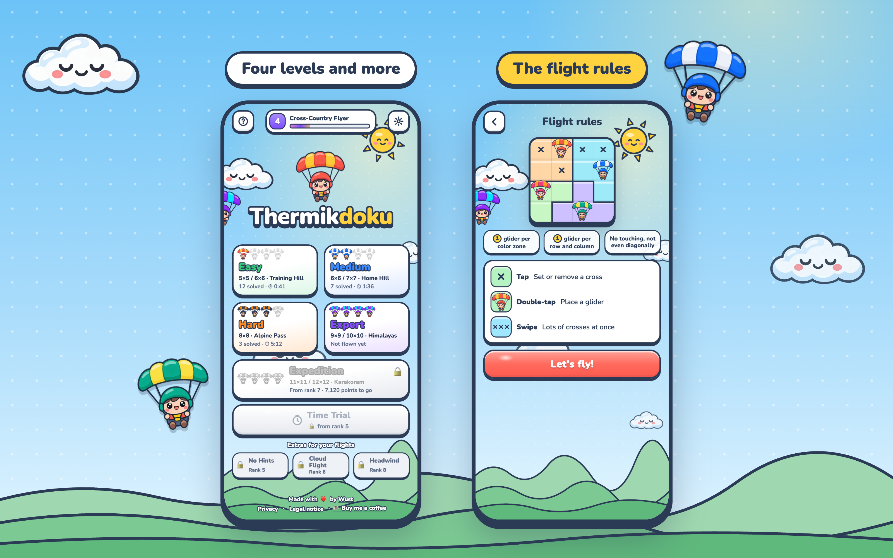
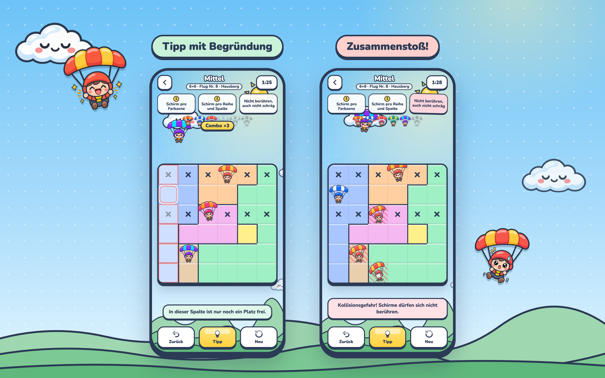
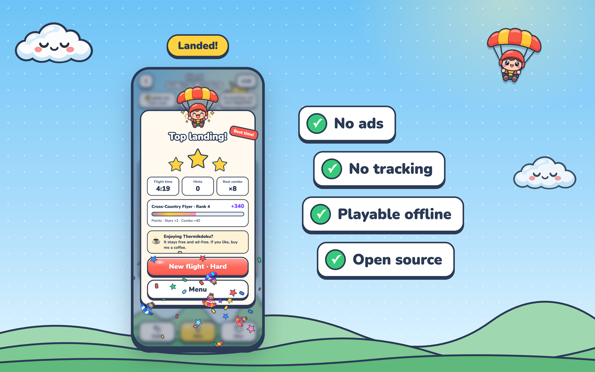

**Lately I've been playing Meowdoku now and then. You might have seen the ads for it. I liked the game, but not the ads in it. So I had it rebuilt.**

---

You may know the idea from LinkedIn's "Queens": every row, every column and every colored zone gets exactly one piece, and pieces may not touch each other. In my version the pieces are paraglider pilots in thermal fields, which is why the game is called **Thermikdoku** (Thermik is German for thermals).

## One hour instead of a few days

Claude Code built it, and ChatGPT drew the pieces. From the first prompt to the finished version it took a little over an hour. Every puzzle is generated fresh, has exactly one solution and can be solved without guessing. The hint button explains the next logical step instead of giving away the answer.

Could I have built this myself earlier? Sure. But it would have cost me days, and I would never have spent them on a game for the train. Today it takes a few prompts.

## On one hand: we're taking the internet back

Thermikdoku has no ads, no tracking and no sign-up, and the code is open on GitHub. Plenty of small apps are full of ads because they were expensive to build. If a clone costs only an hour, that math flips. Then you can build a lot of things yourself and give them away as open source.

## On the other hand: the money still flows

It wasn't free. I pay for Claude every month. The money that used to reach the developers of a small game through ads now goes to one of the big AI companies. If many people do this, we trade many small dependencies for a few very big ones.

I don't know yet how I feel about that.

---

You can play Thermikdoku right in the browser: **[thermikdoku.de](https://thermikdoku.de)**. No ads, promise.

From now on I'll collect more small games for in between at **[games.wust.dev](https://games.wust.dev/en/)**. Also without ads, without sign-up and playable offline.

**What do you think: are we taking the internet back with AI, or just handing it to the next monopolies?**

*Screenshots: real game, save state prepared for the images.*
