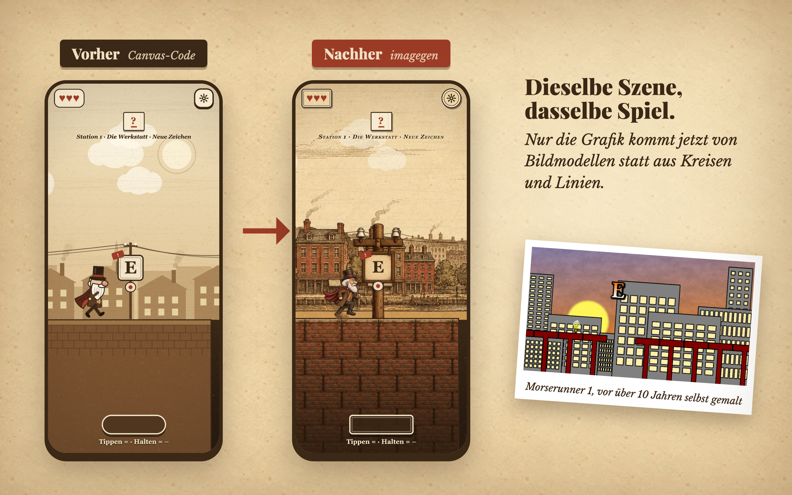
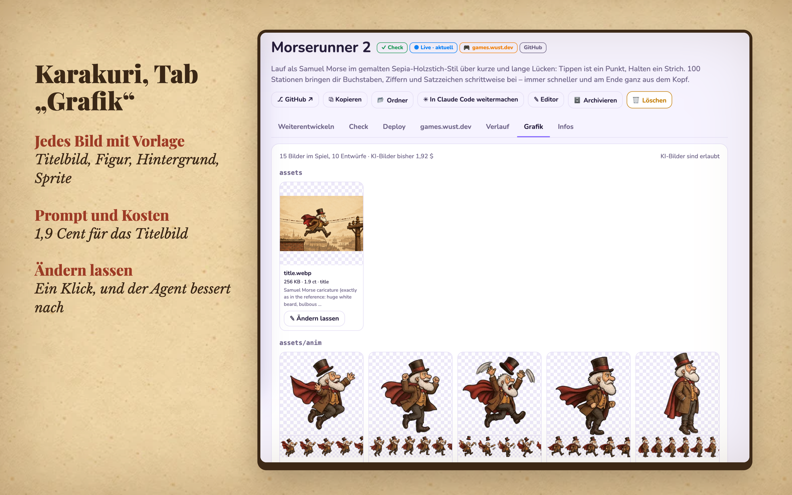
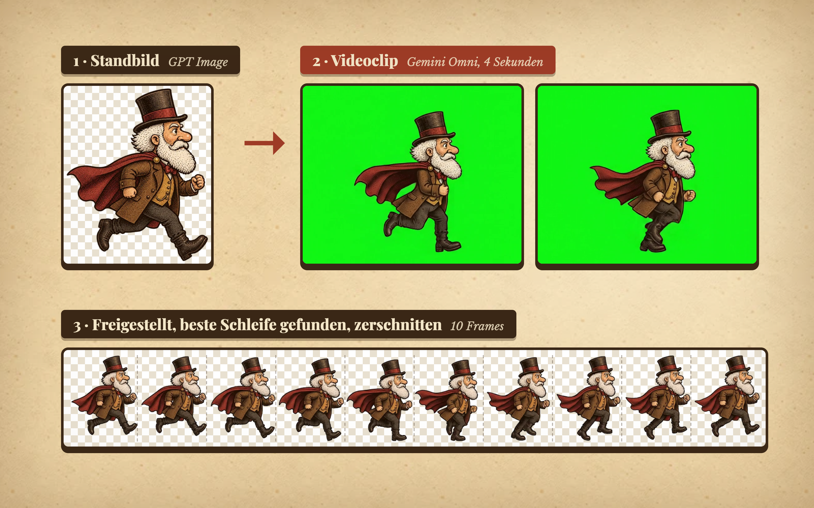

**Morserunner 2 worked, it was fast and it was fun. It just looked like a developer had made it: Samuel Morse built from circles, lines and flat colour, drawn by 742 lines of canvas code. Clean, but no character. A better prompt wouldn't have changed that.**

---

I drew and programmed the [first version of Morserunner](https://morserunner.wust.io/) myself, more than ten years ago. For the sequel, I wanted the AI to take over.

In [Karakuri](https://blog.wust.dev/my-own-app-store/), my factory for browser games, Claude builds every game on its own. Code, logic, copy, tests: it's genuinely good at all of that. Graphics, not so much. It can only put an image together out of code. That gives you clean shapes, but not a character anyone remembers.

So I gave Claude a tool of its own: **imagegen**, a Claude Code plugin that talks to real image models. Claude no longer draws. It commissions.

## From illustrator to art director

An image model on its own doesn't make game art. Every picture would look different, with a white border here or a shadow where none belongs. So imagegen contains the part a graphic designer would normally handle:

- **Style first:** Claude proposes a style and shows a demo image. For Morserunner 2 it was a sepia woodcut from the 1840s. Nothing happens until I agree.
- **Then fixed rules:** The style description and reference images are attached to every call automatically. That keeps Samuel the same in every picture.
- **Presets instead of free prompts:** character, poses, background, icon, title image. Each preset knows its format, transparency and post-processing.
- **Claude looks:** Every result comes back as a preview. If it isn't right, Claude generates it again.

All the still images for the game, drafts and second attempts included, cost 32 cents in total.

## Where one model isn't enough

Then came my feedback: "The running animation is still pretty stiff." Fair point. An image model delivers stills. Two poses in alternation don't make a convincing run.

This is where you need more than one model. For motion, imagegen brings in a video model, Google's Gemini Omni. Claude creates Samuel as a still, and Omni makes him run on the spot. The plugin cuts the figure out, finds the cleanest loop in the clip and slices it into single frames. What ends up in the game is a sprite strip, the kind an animator would have drawn.

The plugin decides which model to use for what. Drafts and small sprites get the cheap tier, the expensive one is reserved for the title image and the main character. Motion is still the expensive part: one clip costs 9 to 28 cents, and Samuel's five animations, test runs included, came to 1.60 dollars. Five times as much as all the images together.

## What I'm taking away

The obvious move would have been to push Claude towards better canvas drawings with ever more precise prompts. That would never have been enough. An agent doesn't have to be able to do everything itself. **It needs the right tools and an eye for what's good.** Claude has the eye. The tools, I had to build.

---

You can try Morserunner 2 at **[morserunner-2.wust.io](https://morserunner-2.wust.io)**, along with the other games on **[games.wust.dev](https://games.wust.dev)**.

**Which task are you still letting your AI do by hand when there's long been a better tool for it?**

*Images: real screens from Karakuri and Morserunner. The art in Morserunner 2 is AI-generated, the art in Morserunner 1 I drew myself. The labels in the images are in German.*
