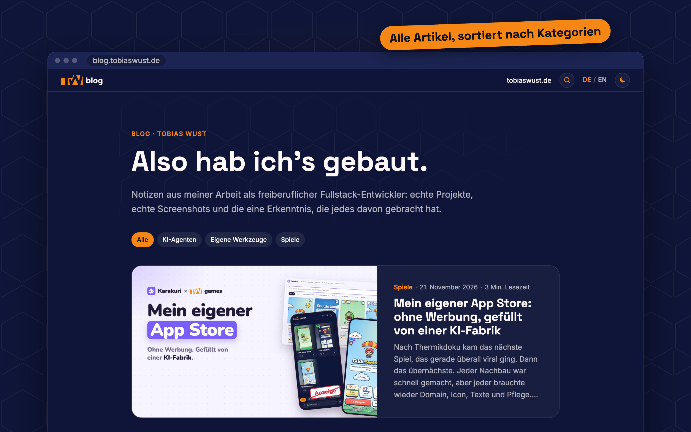
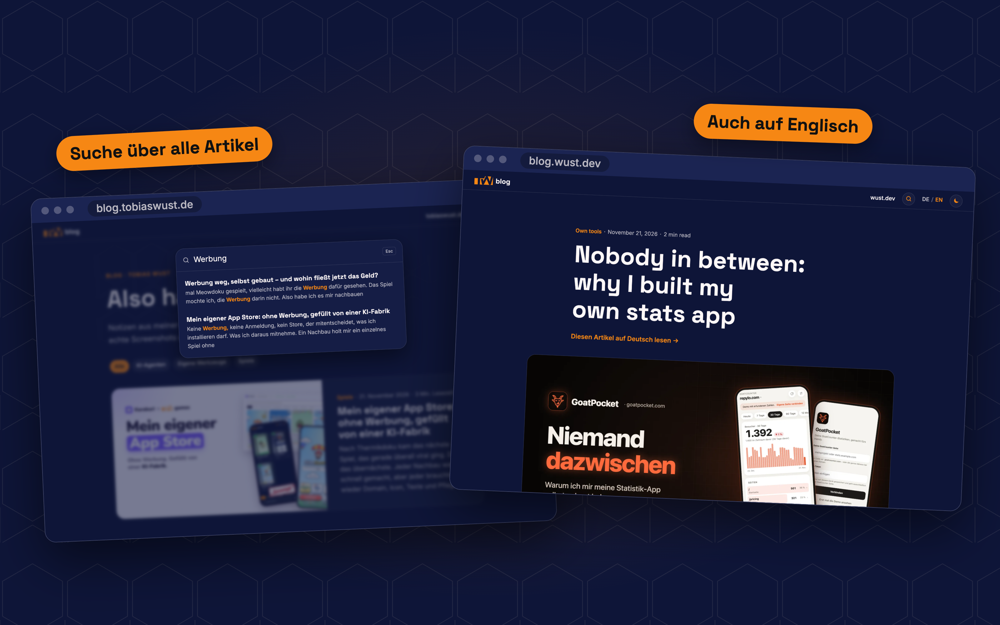

**Over the past few weeks I wrote five articles for LinkedIn. When I wanted to collect them in one place, I got a surprise: LinkedIn doesn't simply hand them back. There's no API for it, only a manual data export.**

---

So now I have a blog of my own: **[blog.wust.dev](https://blog.wust.dev)** in English and **[blog.tobiaswust.de](https://blog.tobiaswust.de)** in German. All my earlier articles are already there, in both languages. From now on, new articles appear there first.

## My writing belongs to me

On LinkedIn, an article lives on someone else's platform. How it's shown, who sees it and whether it still exists in five years isn't up to me. On the blog, every article is a plain text file in my own repository, with its images right next to it. I can take them anywhere I want.

## Findable instead of gone after two days

In the feed, an article has scrolled out of sight after two or three days. On the blog it stays findable: through Google, the search, categories and the [RSS feed](https://blog.wust.dev/rss.xml), for everyone who'd rather read in their feed reader than in the algorithm.

## One place for everything

Until now my projects were scattered: the website on [wust.dev](https://wust.dev), the games on [games.wust.dev](https://games.wust.dev), the articles on LinkedIn. Now they visibly belong together, with the same top bar and linked to each other. If you want to know what I'm working on and what I learn along the way, it's all in one place.

## What changes for you

Nothing big. My articles still go out on [LinkedIn](https://www.linkedin.com/in/tobias-wust/) too, and I'm happy to read your comments there as before. Each article there just notes where the original lives. **If you write on someone else's platform, you should own the original.**

---

**Do you prefer reading technical articles in your feed, or on blogs and via RSS?**
