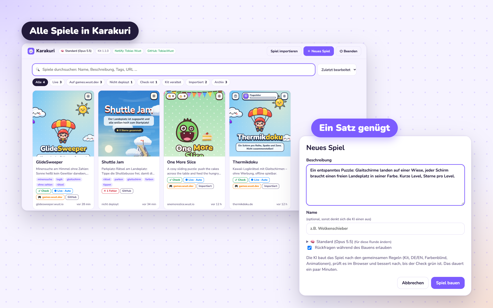
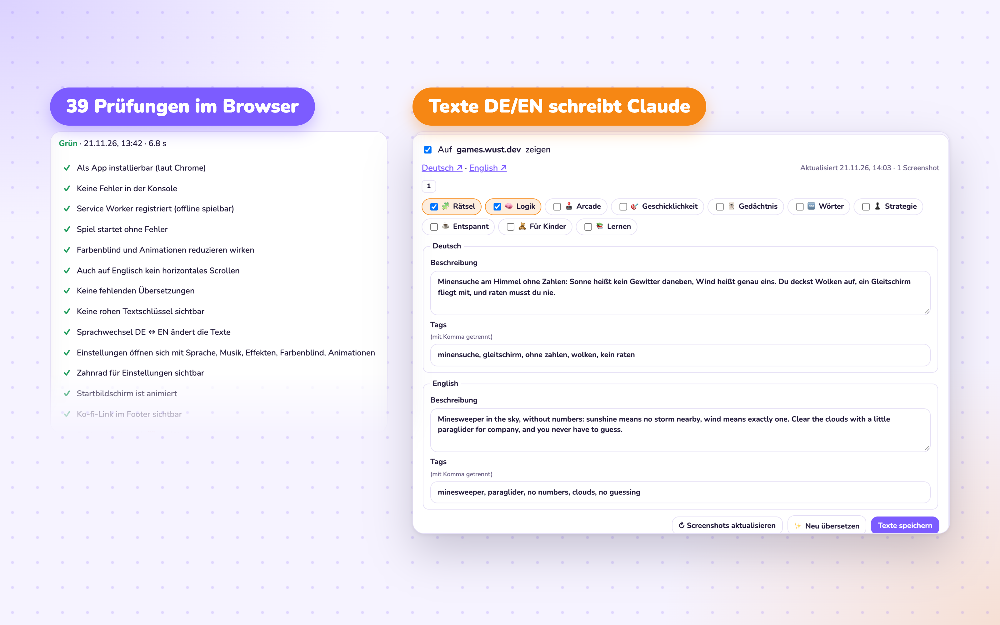
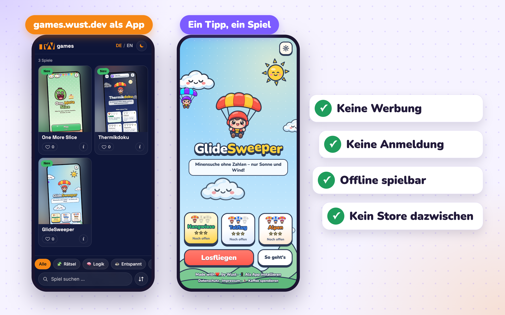

**After Thermikdoku came the next game that was going viral everywhere. Then the one after that. Every clone was quick to build, but each one needed a domain, an icon, copy and upkeep all over again. At some point it was clear: I don't need the next game. I need my own app store.**

---

So in one day I built two things: **Karakuri**, a factory for browser games, and **games.wust.dev**, the launcher where the games end up. Both were built by the AI agents in Grimoire, my software factory for my own tools.

The name comes from Japanese karakuri puppets: mechanical figures that serve tea without anyone lifting a finger. That's what the factory should do. I describe a game in one sentence, and it handles the rest.

## Rules instead of one-offs

A quick clone isn't a good game yet. So in Karakuri, Claude never builds "just something". It builds against fixed rules and a shared kit. Every game has the same settings, runs in German and English, has a colorblind mode, works offline and can be installed as an app.

Karakuri checks all of that itself. After every change it opens the game in a real browser and runs through 39 checks, from "no errors in the console" to "tap targets large enough". If anything is red, Claude fixes it, up to two times. Only what's green goes live. No check can tell me whether a game is fun, though. So I play every one myself, at length, before I tick the box.

## From prompt to phone, no manual work

The real win comes after the building. This is exactly where everything used to stall: setting up hosting, pointing a domain, writing a description, taking screenshots, adding the game to the overview.

Now I enter a domain and tick a box. Karakuri sets up the hosting and puts the game live. Claude writes the description and tags in German and English and picks the categories. The preview image and screenshots come along, and games.wust.dev rebuilds itself. Every new version of a game updates its entry automatically.

## A launcher instead of a store

games.wust.dev can itself be added to the home screen as an app. On a phone the site then turns into a launcher: search and categories sit at the bottom within thumb reach, and one tap starts the game. No ads, no sign-up, no store that gets a say in what I'm allowed to install.

## What I take away from this

A clone gets me one ad-free game back. That's nice, but it doesn't scale as long as manual work piles up afterwards. Only when the path from a single sentence to an icon on the home screen ran by itself did I have more than one game. **If you want to take the platform back, you have to automate the last mile, not just the building.**

---

You can try the launcher at **games.wust.dev**. No ads, promise.

**Which game or app would you want rebuilt ad-free first?**

*Screenshots: real interfaces of Karakuri and games.wust.dev.*
