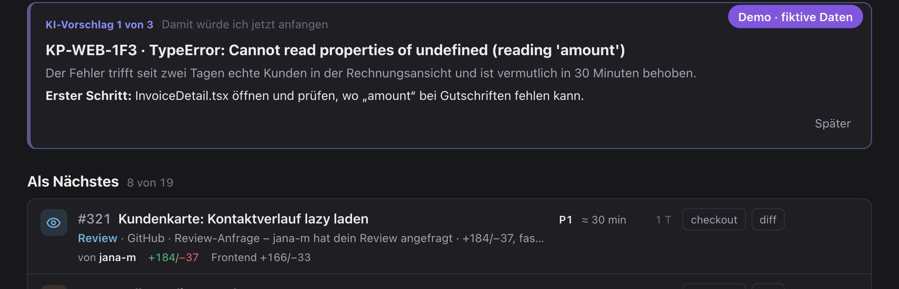
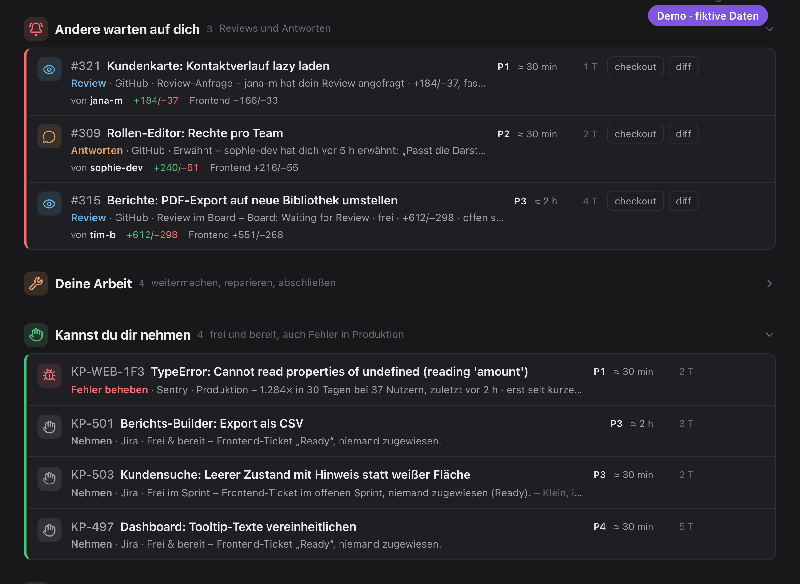
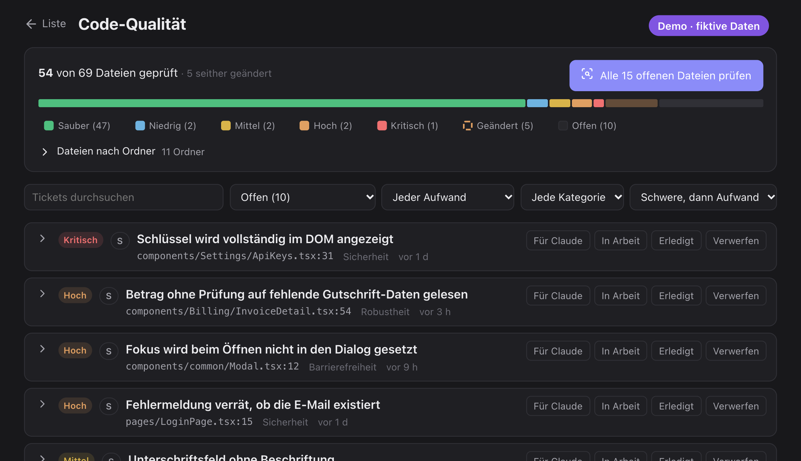
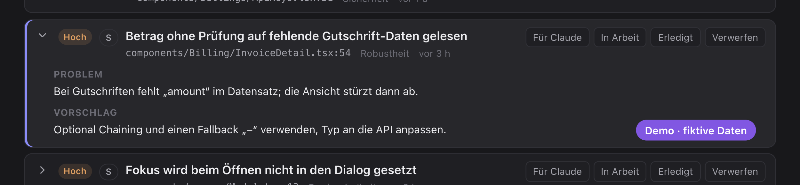
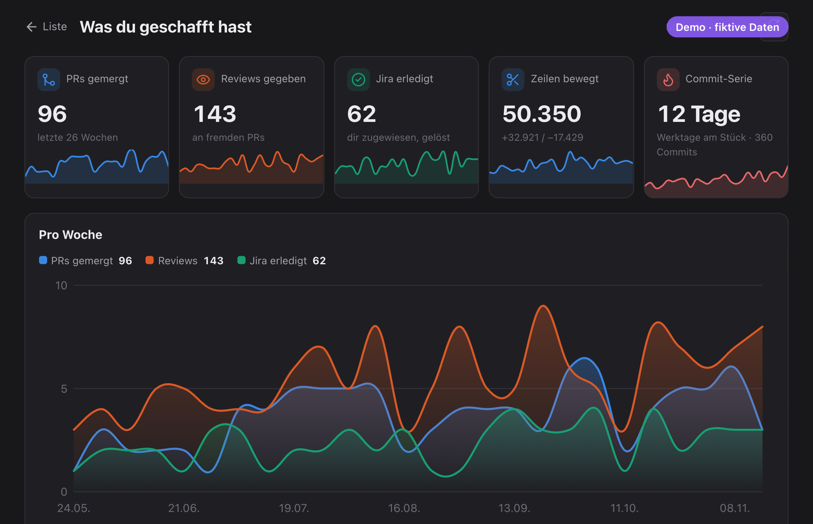

**Someone on my team is waiting for my review on GitHub. Sentry reports a production error. The next ticket is ready in Jira. Where do I start?**

---

I built **cortex.leerlauf** for exactly this moment. The name is the goal: "Leerlauf" is German for idle time, and there should be none between two tasks. No clicking through four tools, no "What was still open?". The app pulls everything from Jira, GitHub, Git and Sentry into one list, and Claude suggests where I should start, with a reason and a first step.

## Two kinds of "urgent"

It got interesting when I asked what "urgent" actually means. There are two kinds. With an open review, someone on the team is stuck until I reply. That is always true. A production error can be more urgent, but it doesn't have to be: it depends on how many users it hits and how big the fix is. The first is a **rule**. The second is a **judgment call**.

That is exactly how the work is split in cortex.leerlauf.

**The rules live in code.** Fixed code decides who is waiting for me, what I can pick up right away and what I first have to clear with the product owner. It is traceable and the same every time.

**Claude makes the judgment call.** The rule decides which section something belongs in. The order across sections is a judgment call. Within that frame, the model estimates effort and priority and picks up to three next steps. In image 1, it puts the production error ahead of the review, because it has been hitting 37 users for two days and can probably be fixed in 30 minutes. I read the reasoning and decide.

## What Claude sees and what it doesn't

- **As little data as possible:** No tools, no source code, no credentials, no ticket descriptions. Only a title, a short reason and a few metrics per item.
- **A fixed shape for the answer:** It has to fit a fixed JSON format. The app discards suggestions for items that don't exist.
- **No call without a reason:** Claude is only asked when something in the list has changed, and at most once an hour. Otherwise the last assessment stays.

## Code quality, always in view

And when nothing is pressing? Then it's the best time to clean up. That's why cortex.leerlauf keeps an eye on code quality all the time. Here it's the other way round from prioritization: for this check, Claude gets the source code but may not change anything. Claude reviews the frontend file by file against our own coding standards and creates tickets with severity, effort and a suggested fix. Here too, a rule decides what gets checked: only files that are new or have changed since the last check. So I can see at any time where the codebase stands, and I always have a useful next task in reserve.

The sanity check needs no AI at all: what actually got done over the last few months? That shows me whether I really get more done or just feel better organized.

## Built by my own agents

cortex.leerlauf was built and extended by the AI agents in **Grimoire**, my software factory for internal tools. Every change there is one sentence from me, for example: "Sentry errors don't belong under 'Others are waiting for you'." Grimoire handles the implementation and the review steps. The new version only goes live after I approve it.

## What I take from this

A good AI system doesn't come from handing the model as much as possible. It comes from knowing exactly **where the rule ends and the judgment call begins**. The payoff is simple: no more idle time, and I do the wrong thing less often.

---

If you don't just want to try out AI, but **use it deliberately** where it really has to weigh things up, let's talk.

**What's at the top of your list: the review someone on your team is waiting for, or the error customers are seeing right now?**

*Screenshots: demo with fictional data.*
