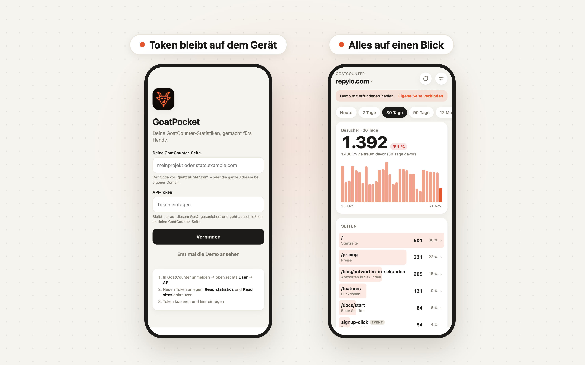
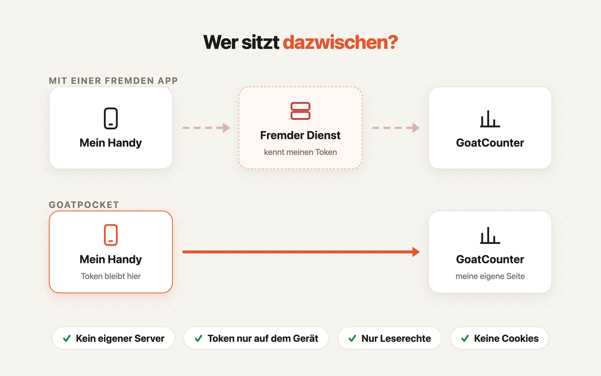
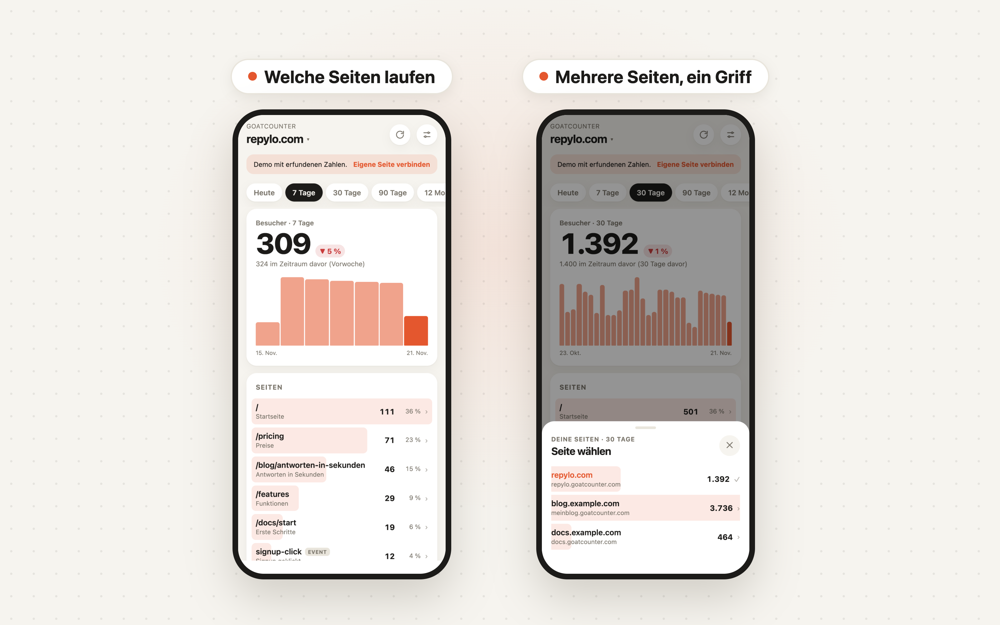

**How many people are playing Thermikdoku right now? The answer is in GoatCounter. But its interface is so awkward on a phone that I opened my laptop every single time.**

---

GoatCounter counts visits without tracking people. That's why I use it for my projects. What was missing was a view for my phone. So I built one in a single evening: **GoatPocket**.

## Privacy as a blueprint, not a promise

In the past, I would have looked for a finished app and handed my API key to some third-party service. For a tool I picked precisely because of privacy.

Today I build things like this myself with Claude Code. That changes the question. It's no longer "Which vendor do I trust?" but "Who needs to be involved at all?" For GoatPocket the answer is: nobody except me and GoatCounter.

- **No server of its own:** It's a plain static site. No data is stored anywhere.
- **The token stays on the device** and only goes to your own GoatCounter site.
- **Read-only access:** The token can read statistics and nothing else.

## Where experience still counts

In production, the first version suddenly returned errors instead of numbers. GoatCounter allows four requests per second, and before every call the browser sends a preflight request that counts too. Now the app throttles itself and caches responses. Limits like these aren't in any prompt. You only find them in production.

## What I take away from this

Privacy is often seen as giving something up. When a tool of your own costs just one evening, that's no longer true. **The most privacy-friendly solution is often the one with nobody in between.**

---

You can try GoatPocket at **goatpocket.com**, even without an account of your own, using demo numbers.

**What small tool would you build so your data no longer runs through someone else's servers?**

*Screenshots: demo with made-up numbers.*
