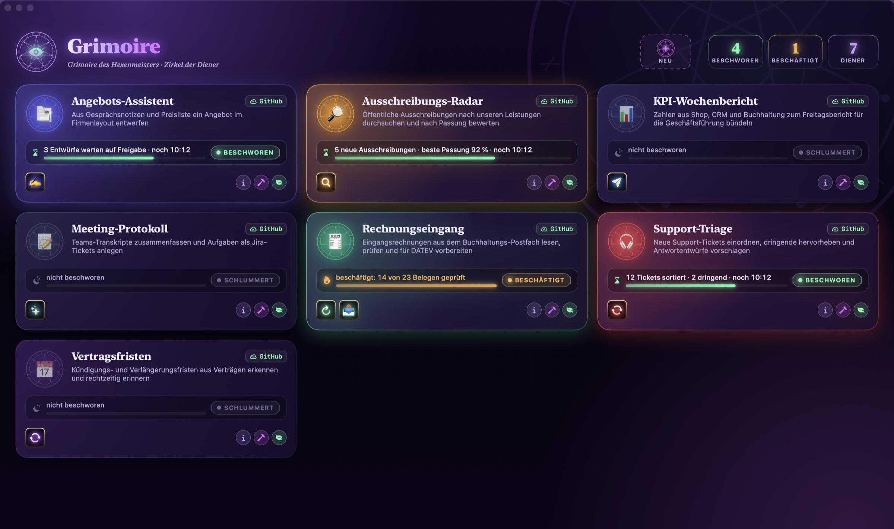

**Playing a warlock in World of Warcraft taught me to summon helpers and lead them. Today I work with AI agents, and the principle still holds: if you delegate, you stay in control.**

---

For a while now, I've been having AI agents build small everyday tools for me. The first version was never the problem. The trouble always came later.

Take a typical tool: it pulls incoming invoices from the accounting mailbox, reads out supplier, amount and due date, and prepares everything for the DATEV export (the standard export format of German accounting software). One sentence to Claude Code, a few follow-up questions, done.

Two weeks later comes the next request:

> "Match every invoice against the open purchase order in the ERP. If the amount differs by more than 2%, it doesn't go into the DATEV export. It goes onto a 'to clarify' list instead."

Sounds like a small business change. In fact, the tool now gets **new access to a core system**, and from now on it decides **which documents end up in the DATEV export**. An AI agent builds that in minutes. On autopilot, it would also push it live right away.

With Grimoire, I wanted to make three things visible instead: What needs to be clarified on the business side? What new access is being added? Who signs off on the change?

## How a warlock became a Grimoire

I used to play a warlock with a lot of passion. What fascinated me about the class: it doesn't have to do everything itself. It has to know which minion to call and when. That was exactly the picture in my head when my collection of AI-built tools got out of hand. The result is **Grimoire**, named after the warlock's spellbook.

Grimoire is a Mac app where AI agents build, run and evolve small tools. Each tool is a card on the dashboard. One click starts it, a status line tells you what's going on ("14 of 23 invoices checked · 2 discrepancies"), and when nobody needs it, it shuts itself down.

That's why I call the tools **minions**. They get **summoned**, do their job, **fade** when idle and can be **banished**. Behind the playful surface are three decisions I made on purpose.

## Decision 1: One contract for every tool

In Grimoire, AI agents never build "just something". They build against the **minion contract**, a fixed specification every tool has to meet, no matter which language it's written in or which agent wrote it:

- a description file with purpose, start command, dependencies, setup steps and the names of the credentials it needs,
- uniform interfaces for status and control,
- a status line, one-click actions and scheduled rituals, such as checking the mailbox at 06:00,
- binding security rules for operation.

Grimoire checks compliance automatically. The result isn't twenty one-off pieces, but twenty tools that behave the same way, are secured the same way and can be moved to another Mac.

## Decision 2: Three questions, three approvals

Back to the ERP change. Grimoire stops at three points. For me, all three questions show up on the same screen, but they are three very different decisions.

**The business question: "How does the agent recognize the matching purchase order?"** Order number on the invoice? Supplier and date? And what about subscriptions that have no order? That's a business decision, and I make it, not the agent.

**The access approval: "May the tool read open purchase orders in the ERP?"** The agent works in a sandbox. When it wants to reach a new system, a prompt appears naming exactly that target. That's a security decision.

**The version approval: "Should the new export rule apply from now on?"** Before adopting it, Grimoire shows which files are new or changed and flags anything that adds network access. I don't have to read every line. I see that the tool will now access the ERP, and I decide whether that fits what I asked for. Only after "Adopt" does the version go live and land in the history.

<figure>
  <video src="/media/grimoire-weiterentwicklung.mp4" controls playsinline preload="metadata"></video>
  <figcaption>Real recording, shortened: the request, approval for ECB access (the European Central Bank), the check step and the result in euros.</figcaption>
</figure>

In a company, these three questions would sit with different people: the business side, IT, and whoever carries the responsibility. That's exactly why I think the separation is crucial once AI agents grow from a solo project into a team.

Getting the dose right was the real work. An early version of Grimoire passed on every prompt from the agent. But Claude Code puts plenty of harmless commands up for approval just because of their shape, even though they never leave the sandbox. If you confirm harmless things ten times a day, you stop reading the eleventh prompt carefully. So today Grimoire allows everything that stays inside the sandbox on its own and only asks about four things: a new network target, commands outside the sandbox, changes to system settings, and files outside the project. **Fewer prompts make each one worth more.**

## Decision 3: Security as a concept, not an afterthought

- **While building:** a sandbox for the agent, write access only in its own project, internet access only to approved sources, everything else only after approval.
- **At runtime:** the tools run locally on the Mac and can't be reached from outside. The contract also requires protection against attacks through manipulated web pages.
- **Credentials** live in the macOS Keychain, never in the project and never in backups.
- **No solo runs:** Grimoire never publishes code on its own, and anything removed goes to the trash instead of being deleted for good.

The concept is written down in its own security document, layer by layer.

## What I take away from this

With Grimoire, the first version of a tool was usually built fast. The real work started with the second: Which questions does the agent need to ask, which access does it need, and what does a human have to see before approving the change? Just like with the warlock: the minions do the work, but whoever summons them makes the call.

---

If you want to bring AI agents into your daily work in a **structured and safe** way, and not just try them out, let's talk.

**Where would you never let your AI work without asking first?**
